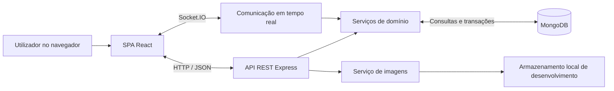

# Do Campo à Mesa

Projeto individual da unidade curricular **Desenvolvimento Web e para a Cloud**, do **Mestrado em Engenharia Informática do IPVC — ESTG**, 1.º semestre de 2026/2027.

## Índice

- [1. Introdução](#1-introdução)
- [2. Objetivos](#2-objetivos)
- [3. Funcionalidades implementadas](#3-funcionalidades-implementadas)
- [4. Tecnologias utilizadas](#4-tecnologias-utilizadas)
- [5. Arquitetura do sistema](#5-arquitetura-do-sistema)
- [6. Implementação das funcionalidades](#6-implementação-das-funcionalidades)
- [7. Segurança e integridade](#7-segurança-e-integridade)
- [8. Metodologia de desenvolvimento](#8-metodologia-de-desenvolvimento)
- [9. Desafios e soluções](#9-desafios-e-soluções)
- [10. Instalação e execução local](#10-instalação-e-execução-local)
- [11. Testes e validação](#11-testes-e-validação)
- [12. Limitações e melhorias futuras](#12-limitações-e-melhorias-futuras)
- [13. Conclusão](#13-conclusão)
- [14. Bibliotecas, ferramentas e IA](#14-bibliotecas-ferramentas-e-ia)

## 1. Introdução

O Do Campo à Mesa aborda a ligação entre produtores locais e consumidores através de um mercado digital. O problema de partida consiste em reunir, numa aplicação, a apresentação dos produtos, as condições de compra, a gestão das encomendas e a venda de lotes por leilão. A motivação do projeto é explorar estes processos num contexto académico, sem pressupor uma avaliação estatística do mercado ou uma utilização comercial efetiva.

A solução desenvolvida combina uma aplicação web responsiva de página única (SPA) com uma API REST e persistência em MongoDB. O catálogo permite descobrir produtos e produtores; as áreas privadas suportam as operações de compradores, produtores e administradores. Os leilões acrescentam um problema de consistência: vários compradores podem apresentar ofertas em simultâneo, mas o valor aceite e o vencedor têm de resultar de uma decisão única do servidor.

A implementação foi validada **localmente**, com React, API, MongoDB e Socket.IO reais. Este relatório explica o trabalho realizado, as decisões adotadas e os respetivos limites. As demonstrações com dados fictícios estão separadas das funcionalidades reais. Não foi realizado deployment nem ativado armazenamento Cloud.

O enunciado original serviu de base à análise. Segundo os esclarecimentos posteriores do docente registados no [guia de execução local](docs/delivery/local-execution.md), Cloud e Laravel são facultativos, o guia é orientativo e os mockups não são vinculativos. A administração foi implementada na própria SPA React. Os [nove documentos originais de requisitos e arquitetura](docs/README.md#requisitos-e-arquitetura-originais--fase-0) permanecem intactos como registo da análise inicial.

## 2. Objetivos

O objetivo geral foi desenvolver uma plataforma que integrasse descoberta de produtos, compra e acompanhamento de encomendas com leilões em tempo real, respeitando a separação de responsabilidades e permissões entre os intervenientes.

Os objetivos específicos foram:

- Construir uma SPA responsiva, com componentes reutilizáveis e navegação adequada a telemóvel, tablet e desktop.
- Desenvolver uma API REST documentada, com validação de pedidos, respostas estruturadas e persistência MongoDB.
- Implementar autenticação e autorização reais, incluindo aprovação de produtores e verificação da propriedade dos recursos.
- Integrar catálogo, fotografias, stock, carrinho e checkout com as condições comerciais de cada produtor.
- Permitir a gestão de encomendas pelo produtor e a confirmação de receção pelo comprador.
- Implementar leilões com licitações concorrentes, histórico persistido e atualização dos clientes por Socket.IO.
- Permitir a compra do lote pelo vencedor, sem duplicar encomendas ou descontar novamente stock reservado.
- Disponibilizar supervisão administrativa, avaliações verificadas e moderação com auditoria.
- Validar modelos, serviços, API e interface através de testes automatizados e revisão manual.

## 3. Funcionalidades implementadas

### Visitante

O visitante consulta o catálogo, pesquisa por nome, ingrediente ou produtor, combina filtros, ordena resultados e percorre páginas. Pode consultar produtos e perfis públicos de produtores, com avaliações e localização quando autorizada. A página inicial apresenta destaques de leilões reais e a listagem pública apresenta resumos dos lotes. O detalhe e o histórico dos leilões exigem autenticação.

É possível preparar uma cesta de visitante. Esta não concede acesso ao checkout e não é automaticamente atribuída a uma conta quando ocorre o login.

### Comprador

O comprador regista-se, inicia sessão e acede às próprias encomendas e avaliações. Dispõe de carrinho independente por conta, compra produtos através de checkout transacional, escolhe as opções de receção e pagamento disponíveis e acompanha os estados das encomendas. Quando a encomenda está pronta, pode confirmar a receção e, depois de concluída, avaliar os produtos e o produtor.

Nos leilões, pode apresentar ofertas, acompanhar a liderança e consultar o histórico. Se vencer, pode confirmar a compra do lote num checkout específico e consultar a encomenda resultante. Não pode licitar num leilão de que seja o produtor, mesmo quando a conta acumula os dois papéis.

### Produtor

O acesso comercial depende de uma candidatura aprovada. O produtor gere os seus produtos, preços, quantidades, fotografias, perfil público e condições comerciais. Pode consultar stock livre, lotes reservados, alertas configurados e indicadores calculados a partir dos dados persistidos.

Na gestão de encomendas, consulta apenas as vendas que lhe pertencem e atualiza a preparação através das transições permitidas. Cria e acompanha leilões, edita-os antes do início quando permitido e cancela-os antes da primeira oferta e do fim. Não confirma a receção em nome do comprador nem escolhe o vencedor manualmente.

### Administrador

O administrador consulta indicadores globais, analisa candidaturas e aprova ou rejeita produtores. Pode pesquisar utilizadores, consultar o histórico e desativar ou reativar contas com justificação. Não existe uma operação genérica de atribuição de papéis ou eliminação de contas na interface.

A supervisão de encomendas e leilões é de leitura. A moderação permite analisar denúncias e ocultar ou restaurar conteúdos dentro das regras previstas, com motivo e auditoria. A apresentação do estado dos serviços Cloud continua **demonstrativa**: não mede disponibilidade nem apresenta serviços externos como operacionais.

As rotas em `/demonstracao/` conservam exemplos visuais com dados fictícios. Escolher um papel nesses exemplos não autentica uma conta nem concede permissões na API real.

## 4. Tecnologias utilizadas

| Área                     | Tecnologias                                                  | Papel na solução                                                                         |
| ------------------------ | ------------------------------------------------------------ | ---------------------------------------------------------------------------------------- |
| Frontend                 | React 19, TypeScript e React Router                          | Componentes, estado tipado e navegação da SPA.                                           |
| Interface                | SCSS, Bootstrap 5, DM Sans e DM Serif Display                | Estilos responsivos, componentes visuais e identidade editorial.                         |
| Mapas                    | Leaflet e OpenStreetMap                                      | Apresentação de um ponto público autorizado, após escolha do visitante.                  |
| Backend                  | Node.js, Express 5 e TypeScript                              | API HTTP modular e execução das regras de negócio.                                       |
| Validação e documentação | Zod, OpenAPI 3.0.3 e Swagger UI                              | Validação de entradas e descrição interativa das operações.                              |
| Base de dados            | MongoDB e Mongoose                                           | Documentos, validações, índices, consultas e transações.                                 |
| Tempo real               | Socket.IO                                                    | Salas de leilão, presença e notificações privadas de encomendas.                         |
| Segurança                | JWT com `jose`, Argon2id e `bcryptjs`                        | Tokens assinados, novas palavras-passe com hash e compatibilidade com hashes anteriores. |
| Fotografias              | Sharp                                                        | Descodificação, validação e normalização das imagens enviadas.                           |
| Testes                   | Vitest, Supertest e Playwright                               | Testes unitários, HTTP, integração MongoDB e percursos no navegador.                     |
| Desenvolvimento          | npm workspaces, Vite, Docker Compose, ESLint, Prettier e Git | Organização do repositório, execução local, compilação e verificação do trabalho.        |

As versões reproduzíveis das dependências estão registadas no [lockfile](package-lock.json). A escolha de TypeScript nos dois lados permite verificar contratos internos durante o desenvolvimento; a validação em execução continua necessária para os dados recebidos pela rede.

## 5. Arquitetura do sistema

A solução está organizada num monorepo com aplicações independentes para frontend e backend. A interface não acede diretamente ao MongoDB. Os pedidos HTTP e as mensagens Socket.IO passam pelo servidor, que aplica autenticação, validações e regras de negócio.



API e Socket.IO partilham o servidor HTTP e os serviços de domínio. O diagrama representa a execução local implementada; não representa uma instalação Cloud.

### 5.1 Frontend

A SPA usa React Router para separar páginas públicas e áreas privadas. As funcionalidades estão agrupadas por domínio, com componentes, contratos, modelos de estado e acesso remoto. Componentes como cartões, campos de formulário, diálogos de confirmação e estados de carregamento são reutilizados nas várias áreas.

A sessão e o carrinho usam contextos React. O cliente HTTP acrescenta o token quando necessário e trata erros estruturados. As leituras podem ser canceladas; respostas de pedidos antigos não devem substituir dados de uma sessão mais recente. Os estilos seguem uma abordagem Mobile First, com variáveis, mixins e parciais SCSS. A identidade visual e os componentes estão descritos no [design system](docs/design/design-system.md).

### 5.2 Backend

A API Express separa configuração, ligação à base de dados, infraestrutura HTTP e módulos de domínio. As rotas validam parâmetros, query e corpo; os serviços executam as regras e coordenam persistência e transações. As respostas usam projeções próprias, ou DTOs, para devolver apenas os campos necessários a cada operação.

Esta separação evita colocar regras comerciais nos componentes React ou confiar em campos enviados pelo cliente, como proprietário, permissões, totais ou vencedor. Os erros têm códigos estáveis e mensagens sem detalhes internos. O ciclo de arranque prepara ligações e índices; o encerramento liberta os recursos do servidor.

A especificação [OpenAPI](docs/api/openapi.yaml) inclui contratos e propostas históricas identificadas. A Swagger UI em `/api-docs/` seleciona as operações efetivamente montadas na aplicação, em vez de apresentar propostas como funcionalidades disponíveis.

### 5.3 Base de dados

| Entidade          | Responsabilidade e relações principais                                                        |
| ----------------- | --------------------------------------------------------------------------------------------- |
| `users`           | Identidade, hash da palavra-passe, papéis e estado da conta.                                  |
| `producers`       | Perfil, candidatura, aprovação e condições comerciais; referência à conta proprietária.       |
| `products`        | Produto, unidade de venda, preço, stock e fotografias; referência à conta produtora.          |
| `orders`          | Compra de um produtor por um comprador, linhas, condições acordadas e históricos.             |
| `auctions`        | Lote, prazo, liderança, reserva, resultado e eventual encomenda associada.                    |
| `bids`            | Ofertas aceites, ligadas ao leilão e ao comprador, com sequência e dados de repetição segura. |
| `reviews`         | Avaliações de compras concluídas, ligadas à encomenda e ao produto ou produtor.               |
| `content_reports` | Denúncias, evidências e decisões de análise.                                                  |

Existem ainda registos auxiliares de imagens, auditoria e coordenação de operações. As contas e os perfis de produtor são separados porque uma mesma identidade pode acumular capacidades, sem confundir aprovação comercial com autenticação.

As linhas e condições da encomenda são **embebidas** no documento: são lidas em conjunto e devem conservar o nome, o preço e as condições acordadas, mesmo que o catálogo mude. Os utilizadores, produtos e perfis são **referenciados**, pois são partilhados por várias operações. As licitações ficam numa coleção própria, em vez de fazer crescer o documento do leilão a cada oferta. Esta escolha permite consultar o histórico por páginas e aplicar índices de sequência e unicidade.

Mongoose valida os documentos; os serviços verificam relações e elegibilidade. As referências, por si só, não comprovam autorização. Transações MongoDB coordenam escritas em várias coleções, pelo que o ambiente local utiliza replica sets.

### 5.4 Comunicação em tempo real

Socket.IO permite subscrever salas de leilão e receber atualizações privadas de encomendas. A ligação usa a identidade autenticada e o servidor verifica o acesso às subscrições. As ofertas passam pelos mesmos serviços e regras de consistência, independentemente do transporte utilizado.

O fluxo é: receber o pedido, validar e persistir, confirmar a transação e só depois comunicar o estado aos clientes. As versões e sequências permitem rejeitar atualizações antigas. Após uma reconexão ou uma indicação de alteração, o frontend consulta REST para reconciliar o estado. MongoDB permanece a fonte de verdade; uma mensagem recebida não substitui a confirmação persistida.

```text
apps/web/        SPA, recursos públicos e testes Playwright
apps/api/        API, modelos, serviços, scripts e testes backend
packages/shared/ Espaço reservado para código partilhado
scripts/         Preparação explícita do catálogo de desenvolvimento
docs/            Requisitos, arquitetura, contratos, decisões e guias
```

## 6. Implementação das funcionalidades

### 6.1 Autenticação e perfis

O registo cria uma conta compradora. O cliente não pode escolher o papel de administrador ou produtor no pedido. A API responde com HTTP 202 e uma mensagem genérica, incluindo quando o email já existe, sem apresentar essa resposta como verificação de email.

No login, o servidor verifica o hash e o estado da conta e emite um JWT HS256 com expiração. O frontend conserva o token apenas em memória e consulta a identidade na API. Em cada pedido autenticado, o backend volta a verificar a conta e os papéis atuais: um token emitido antes da desativação não mantém acesso a uma conta inativa. Atualizar a página exige novo login; logout descarta a sessão no cliente, sem revogar antecipadamente o token no servidor.

A candidatura de produtor é um processo separado. Uma conta ativa submete os dados, acompanha o estado e pode reapresentar uma candidatura rejeitada. A decisão administrativa usa a versão atual do recurso. A aprovação e a atribuição da capacidade de produtor são guardadas na mesma transação, com histórico, sem publicar produtos automaticamente.

### 6.2 Catálogo e produtos

Pesquisa, filtros, ordenação e paginação são executados no backend sobre MongoDB. A pesquisa inclui nome, ingredientes e informação pública do produtor; filtros permitem combinar categoria, localidade, época e modo de produção. O texto de pesquisa é validado e escapado antes da construção das expressões regulares. Agregações obtêm resultados e contagens sem carregar todo o catálogo no navegador.

Os produtos distinguem rascunho, publicação e arquivo. Um rascunho pode estar incompleto; a publicação exige os dados comerciais obrigatórios e um produtor elegível. O arquivo lógico preserva referências históricas. As categorias usam identificadores estáveis e os valores monetários são representados em cêntimos inteiros. Preços por kg/L coexistem com quantidades em g/ml; unidades e embalagens têm regras próprias de mínimo e incremento.

O produtor gere até duas fotografias por produto. O servidor descodifica JPEG, PNG ou WebP, verifica limites e converte para WebP, removendo metadados originais. Os ficheiros enviados ficam fora do repositório e só são servidos quando a associação e a visibilidade o permitem. O adaptador de disco é exclusivo de desenvolvimento/teste.

O stock editável corresponde à quantidade livre. Reservas de leilões são apresentadas separadamente. Um limiar opcional por produto permite identificar stock reduzido; não é inventado um valor por defeito. A edição usa ETag para impedir que um formulário antigo reponha quantidades entretanto consumidas. A [documentação da gestão do produtor](docs/api/phase-11a-producer-management.md) detalha estas regras.

No perfil público, o mapa só carrega após escolha do visitante e quando existe um ponto cuja publicação foi autorizada pelo produtor. A localização pode ser removida e não é inferida a partir da morada privada de levantamento.

### 6.3 Carrinho e checkout

O carrinho combina estado React com persistência em `localStorage`, numa chave identificada pelo ID estável da conta. Ao mudar de identidade, o estado apresentado também muda. Pedidos assíncronos conservam a identidade de origem, para impedir que uma resposta antiga altere a cesta de outro comprador.

Após logout, deixam de ser apresentados os artigos dessa conta; novo login recupera-os no mesmo navegador. A cesta de visitante é independente e só é importada mediante confirmação explícita. A chave antiga sem proprietário é conservada sem atribuição automática, porque não permite saber a quem pertenciam os artigos. A persistência não sincroniza dispositivos nem constitui uma barreira contra quem tem acesso ao próprio perfil do navegador.

No checkout, o servidor confirma os produtos, as quantidades, o stock e as condições comerciais atuais. O comprador escolhe levantamento ou entrega, período e método de pagamento entre as opções configuradas por cada produtor. Dinheiro, MB Way e transferência bancária são opções registadas; não existe integração bancária que execute ou confirme esses pagamentos.

Uma compra com vários produtores origina uma encomenda por produtor, ligada à mesma operação de compra. A transação cria as encomendas e desconta stock de forma coordenada: uma falha não deve deixar apenas parte da compra concluída. O cliente não determina o preço final nem pode impor condições inexistentes.

O cabeçalho `Idempotency-Key` identifica a tentativa. A mesma chave com o mesmo pedido permite recuperar o recibo; a reutilização com conteúdo diferente é recusada. Quando uma resposta se perde, a interface oferece recuperação com a mesma tentativa, evitando interpretar a ausência de resposta como prova de que nada foi gravado.

### 6.4 Gestão de encomendas

Cada encomenda referencia um comprador e um produtor e conserva snapshots dos artigos e condições da venda. O comprador consulta as suas compras; o produtor consulta apenas as vendas que lhe pertencem, sem receber as encomendas de outros produtores da mesma operação.

O percurso operacional exposto é `pendente → confirmada → em_preparacao → pronta → concluida`. O produtor executa as três primeiras transições. A passagem de pronta para concluída depende da confirmação de receção pelo comprador, através de `PATCH /api/orders/:id/receipt`. A compatibilidade com o estado `entregue` do enunciado reutiliza esta operação, sem permitir ao produtor confirmar a receção por outra pessoa.

As alterações verificam propriedade, estado e versão. A confirmação guarda a conclusão e a auditoria na mesma transação, sem alterar stock ou estado do pagamento. Os históricos de preparação, receção e pagamento são distintos; encomenda concluída não significa pagamento recebido.

Socket.IO avisa os clientes autorizados de alterações e a interface volta a consultar a API. A confirmação da receção torna a compra elegível para avaliação. O [documento de encomendas e notificações](docs/api/phase-10-orders-realtime.md) descreve a concorrência e a recuperação de pedidos repetidos.

### 6.5 Leilões em tempo real

O produtor cria um leilão a partir de um produto próprio elegível, indicando quantidade do lote, preço base, incremento e datas. A criação reserva a quantidade, retirando-a do stock livre. Se o leilão for cancelado quando permitido ou terminar sem ofertas, o mecanismo de libertação trata a reserva; com vencedor, o lote fica afeto a esse comprador.

A aceitação de uma oferta não depende do temporizador do navegador. O servidor verifica a conta, a ausência de auto-licitação, o prazo e o mínimo exigido. A liderança começa no preço base, sem uma oferta fictícia; a primeira licitação tem de atingir base mais incremento. Os atalhos +5/+10/+25 € somam ao último valor confirmado e preparam uma proposta que exige confirmação.

A decisão usa uma atualização condicional atómica em MongoDB, com a versão, a sequência e o relógio `$$NOW`. A mudança da liderança e a inserção da oferta pertencem à mesma transação. Duas ofertas iguais que concorram sobre o mesmo valor não podem ser ambas aceites: depois da primeira escrita confirmada, a outra tem de ser reavaliada e já não satisfaz o mesmo mínimo. Os detalhes constam da [especificação dos leilões](docs/api/phase-6a-auctions.md).

Depois do commit, Socket.IO comunica o estado. O cliente apresenta valor atual, tempo estimado, presença, histórico e feedback da oferta. A contagem decrescente usa uma estimativa do relógio do servidor; o prazo é fixo, sem extensões automáticas. Uma oferta elegível antes do fim pode terminar o commit depois desse instante. O encerramento concorre com as ofertas através do mesmo estado persistido e fixa o resultado. Após desconexão, a consulta REST recupera o estado e o histórico confirmados.

### 6.6 Compra de lotes vencedores

Vencer um leilão não cria automaticamente uma encomenda nem processa um pagamento. Só o vencedor autenticado e ativo pode preparar e confirmar a compra em `/checkout/leilao/:id`. A API obtém o vencedor, o produto, a quantidade e o preço dos registos persistidos, sem aceitar esses valores como escolha livre do cliente.

O lote é representado na encomenda como uma embalagem comercial indivisível, com a quantidade física original no snapshot. Assim, o valor vencedor é o preço total do lote, sem inventar um preço por kg ou litro. O comprador seleciona as condições atuais de receção e pagamento do produtor, reutilizando os componentes do checkout normal.

`GET` e `POST /api/auctions/:id/checkout` preparam e confirmam esta operação. A transação cria a encomenda, associa-a ao leilão e consome a reserva afeta ao vencedor. **Não volta a descontar o stock** reservado na criação. Um índice único para a origem do leilão e a escrita condicional impedem duas encomendas para o mesmo lote; a idempotência permite recuperar a compra confirmada.

A cesta normal permanece independente. A encomenda do lote surge nas áreas do comprador e do produtor e segue a preparação e receção habituais. Se as condições comerciais deixarem de ser elegíveis, a compra fica pendente: não se inventa uma modalidade de entrega nem se transfere o lote para outro licitador. Ver [carrinhos e compra de lotes vencedores](docs/api/phase-14.2-cart-auction-purchase.md).

### 6.7 Administração e moderação

Os indicadores administrativos resultam de consultas aos dados persistidos. Erros de consulta não são convertidos em contagens fictícias. As decisões de candidaturas e de estado das contas exigem autorização atual, versão do recurso e auditoria. A desativação da própria conta administrativa e do último administrador ativo é recusada.

A supervisão permite consultar encomendas e leilões, com filtros, paginação e históricos. Essa leitura global não concede poderes para modificar a preparação de uma encomenda, licitar, cancelar arbitrariamente um leilão ou escolher outro vencedor. Os dados dos licitantes são pseudonimizados nas projeções adequadas.

Contas autenticadas e ativas podem denunciar produtos, perfis públicos e avaliações, com motivo e sem ocultação automática. A administração analisa o conteúdo e a evidência, decide com justificação e conserva auditoria. Ocultar um produto impede novas compras e novas criações de leilão desse produto; ocultar um perfil retira a loja da descoberta pública e de novas compras. Encomendas existentes são preservadas.

Nos leilões já criados, a moderação pode retirar a descoberta pública e neutralizar a apresentação do conteúdo, mas não muda preço, prazo, ofertas, reserva ou vencedor. Restaurar conteúdo repõe apenas a visibilidade permitida pelos estados comerciais atuais. Estas diferenças estão documentadas na [moderação de conteúdos](docs/api/phase-11d-content-moderation.md).

### 6.8 Avaliações de compras concluídas

A elegibilidade é verificada no backend a partir de uma encomenda própria concluída. Existe uma avaliação por encomenda e produto e uma avaliação direta do produtor por encomenda, com classificação de 1–5 e comentário obrigatório. Os índices de unicidade impedem duplicados mesmo com pedidos concorrentes.

O comentário e a classificação não são editados pela moderação. É possível ocultar ou restaurar a publicação com motivo, ETag e auditoria. As consultas públicas e as médias excluem avaliações ocultadas; as médias dos produtos e as avaliações diretas do produtor são apresentadas separadamente. O histórico próprio permite ao comprador consultar o conteúdo que submeteu.

## 7. Segurança e integridade

As novas palavras-passe são guardadas com **Argon2id**; hashes bcrypt anteriores continuam verificáveis. Esta é uma decisão documentada, diferente do exemplo bcrypt do enunciado, e não uma alegação de cumprimento literal desse exemplo. Os hashes e as palavras-passe não integram as respostas públicas.

JWT usa assinatura HS256, segredo de ambiente, emissor, destinatário e expiração. O token não é guardado em `localStorage`, `sessionStorage` ou URLs. A autorização combina papel atual, estado ativo, aprovação comercial e propriedade, conforme a operação. Esconder um botão não substitui estes controlos no backend.

Zod valida entradas HTTP, incluindo campos permitidos, identificadores e limites. Mongoose valida a persistência e os serviços aplicam regras entre entidades. O sistema usa limites de pedidos em operações sensíveis, origens CORS explícitas e configuração de proxy. Existem verificações de HTTPS para produção; a execução local descrita usa HTTP de loopback e não comprova uma instalação HTTPS publicada.

Preços e totais são verificados no servidor. Escritas condicionais protegem stock e transições; transações coordenam operações compostas. ETags enviados em `If-Match` impedem alterações sobre versões antigas, enquanto as chaves de idempotência protegem a repetição de compras e ofertas. Estas duas medidas resolvem problemas diferentes: versão desatualizada e repetição da mesma operação.

As respostas privadas usam projeções e os erros não expõem hashes, segredos ou detalhes internos. A separação das cestas por conta evita a mistura acidental entre sessões, mas o armazenamento do navegador não substitui a autorização da API. Não se afirma segurança absoluta, certificação de acessibilidade ou conformidade com normas não verificadas. Os limites atuais são explicitados na [secção 12](#12-limitações-e-melhorias-futuras).

## 8. Metodologia de desenvolvimento

O trabalho começou pela análise dos requisitos, casos de uso, modelo de dados e arquitetura. Seguiu-se uma implementação progressiva: primeiro a interface navegável com dados demonstrativos, depois os modelos e serviços backend e, por fim, a integração dos percursos reais. A documentação original foi preservada para permitir distinguir a intenção inicial das decisões posteriores.

Autenticação, catálogo, checkout e encomendas estabeleceram a base para os leilões. As funcionalidades de tempo real reutilizaram os serviços de domínio, em vez de criarem regras alternativas nos sockets. A administração e a moderação foram integradas sobre os mesmos modelos e mecanismos de autorização.

Cada bloco foi acompanhado por testes adequados ao seu âmbito e por verificações de TypeScript, estilo e compilação. As integrações reais usaram bases isoladas e contas fictícias. A revisão visual em várias larguras e os testes manuais permitiram identificar problemas que as verificações iniciais não tinham detetado, incluindo o isolamento do carrinho e a compra de lotes vencedores.

O Git registou a evolução e a documentação técnica reuniu decisões e limitações, permitindo relacionar os requisitos com a implementação e as verificações realizadas.

## 9. Desafios e soluções

| Desafio verificado                                                    | Solução adotada                                                                                      | Resultado e limite                                                                                            |
| --------------------------------------------------------------------- | ---------------------------------------------------------------------------------------------------- | ------------------------------------------------------------------------------------------------------------- |
| O carrinho anterior partilhava estado e armazenamento entre sessões.  | Separação por ID da conta, substituição do estado React e rejeição de respostas de outra identidade. | Logout deixa de mostrar a cesta privada e novo login recupera-a; continua local ao navegador.                 |
| Uma cesta de visitante não tem proprietário autenticado.              | Importação explícita e conservação da chave antiga sem atribuição automática.                        | Evita associar silenciosamente artigos de outra pessoa; exige confirmação do utilizador.                      |
| Ofertas simultâneas podem disputar a mesma liderança.                 | Predicado atómico, versão e sequência, relógio MongoDB e transação com a oferta persistida.          | Apenas uma das ofertas concorrentes iguais mantém elegibilidade; clientes reconciliam o resultado confirmado. |
| Compras normais e reservas de leilão disputam stock.                  | Escritas condicionais e separação entre stock livre e quantidade reservada.                          | Evita vender a mesma disponibilidade e impede que uma edição antiga reponha stock consumido.                  |
| Uma resposta perdida pode levar a repetir uma compra já gravada.      | Chave de idempotência, representação canónica do pedido e recuperação do recibo.                     | A repetição segura recupera o resultado; um resultado incerto não é apresentado como falha definitiva.        |
| O preço vencedor é total do lote e o stock já está reservado.         | Checkout próprio com lote indivisível, preço persistido, origem única e consumo da reserva.          | Cria uma encomenda gerível pelo produtor, sem conversões artificiais de preço nem segundo débito.             |
| Uma conta ou aprovação pode mudar durante uma operação.               | Revalidação e guardas de revisão dentro das transações relevantes.                                   | A operação não depende apenas dos papéis de um token antigo.                                                  |
| Condições comerciais incompletas impedem escolher uma receção válida. | Configuração explícita por produtor e validação na preparação e confirmação.                         | A aplicação informa o bloqueio, sem inventar horários, moradas ou modalidades.                                |

Os testes manuais também evidenciaram a importância de usar as credenciais da base efetivamente servida. O ambiente de revisão gera dados próprios por execução; o guia passou a distinguir esses dados dos registos persistentes e a explicar a consulta dos ficheiros privados de contas.

## 10. Instalação e execução local

Executar os comandos a partir da raiz do repositório. O [guia técnico de execução local](docs/delivery/local-execution.md) complementa esta secção com percursos por papel e resolução de problemas.

### 10.1 Pré-requisitos e instalação

São necessários Node.js **22.21.1** ou uma versão compatível de Node.js 24, npm 10 ou superior e Docker com Compose. Os testes Playwright estão configurados para Google Chrome instalado.

Numa cópia nova, instalar as versões do lockfile:

```sh
npm ci
```

Os exemplos [da API](apps/api/.env.example) e [do frontend](apps/web/.env.example) não contêm credenciais reais. As variáveis `VITE_*` são públicas e nunca devem receber segredos JWT ou credenciais MongoDB. Não é necessário instalar novamente as dependências para rever uma cópia já preparada.

### 10.2 Ambiente de revisão isolado

Este modo utiliza serviços reais e uma base MongoDB aleatória de teste, com contas fictícias e fotografias temporárias. Não precisa de contas Cloud e não deve ser apontado para dados de produção ou uma base partilhada.

Iniciar o replica set de teste:

```sh
npm run mongo:test:up --workspace @docampo/api
```

No primeiro terminal, iniciar a API com os cenários de revisão:

```sh
DOCAMPO_AUCTION_REVIEW=1 \
DOCAMPO_ADMIN_APPLICATION_REVIEW=1 \
DOCAMPO_REVIEWS_REVIEW=1 \
DOCAMPO_RECEIPT_REVIEW=1 \
node --import tsx apps/web/tests/support/real-api-server.mjs
```

No segundo terminal, iniciar o frontend:

```sh
VITE_API_URL=http://127.0.0.1:3011/api npm run dev --workspace @docampo/web -- --port 5183
```

| Serviço    | Endereço                          |
| ---------- | --------------------------------- |
| Aplicação  | <http://127.0.0.1:5183>           |
| API REST   | <http://127.0.0.1:3011/api>       |
| Swagger UI | <http://127.0.0.1:3011/api-docs/> |

A API indica os caminhos dos ficheiros temporários de contas, protegidos com permissões `0600`. Usar email e palavra-passe do mesmo bloco, dos ficheiros indicados pelo servidor **atualmente em execução**. O cenário de leilões fornece dois compradores e um produtor; os restantes cenários acrescentam perfis e dados para revisão administrativa, avaliações e receção. Usar contas, produtos e encomendas do mesmo cenário. Não copiar credenciais para o repositório ou para o relatório.

A sessão expira, por omissão, ao fim de 15 minutos e fica apenas em memória. Atualizar a página exige novo login. Para testar duas pessoas em simultâneo, usar perfis de navegador diferentes ou uma janela normal e outra privada.

`Ctrl+C` encerra os processos. O encerramento normal da API elimina a base efémera e os ficheiros dessa execução, **incluindo os registos criados manualmente nessa base**. Não reiniciar este ambiente para tentar corrigir credenciais; para conservar dados entre execuções, usar o modo persistente seguinte.

### 10.3 Ambiente de desenvolvimento persistente

Criar `apps/api/.env` a partir do exemplo apenas se ainda não existir. Definir um `JWT_SECRET` aleatório com pelo menos 32 bytes em base64url, sem o versionar. É possível gerar o valor no terminal local com:

```sh
node -e "console.log(require('node:crypto').randomBytes(32).toString('base64url'))"
```

Conferir `MONGODB_URI`, `MONGODB_DB_NAME`, `CORS_ORIGINS` e a pasta externa de fotografias. O exemplo aponta para o replica set local na porta 27018. O frontend utiliza `VITE_API_URL=/api` por omissão; o proxy Vite encaminha `/api` e `/socket.io` para a API na porta 3001.

Preparar o MongoDB e o catálogo dedicado:

```sh
npm run mongo:dev:up --workspace @docampo/api
NODE_ENV=development node --import tsx scripts/seed-catalog.mjs
```

Iniciar backend e frontend em terminais separados:

```sh
MONGODB_DB_NAME=docampo_dev_catalog CORS_ORIGINS=http://127.0.0.1:5173 npm run dev --workspace @docampo/api
```

```sh
npm run dev
```

Abrir <http://127.0.0.1:5173> e Swagger em <http://127.0.0.1:3001/api-docs/>. O seed prepara o catálogo de desenvolvimento sem substituir ou apagar registos existentes; não fornece palavras-passe reutilizáveis nem cria um administrador. Para rever os três papéis, preferir o ambiente isolado. O modo persistente não preenche automaticamente condições comerciais que faltem a dados antigos.

### 10.4 Demonstração dos leilões

Em `/leiloes`, entrar com dois compradores e acompanhar o mesmo lote. Confirmar ofertas, mudança de liderança e histórico; após o encerramento, o vencedor usa **Finalizar compra**. O produtor consulta a encomenda associada e prepara-a pelo fluxo normal.

Existe também uma demonstração automática com dois clientes Socket.IO e MongoDB reais:

```sh
DOCAMPO_AUCTION_DEMO=1 npm run demo:auctions --workspace @docampo/api
```

Requer MongoDB de teste ativo e termina os recursos efémeros que cria. Não substitui a revisão visual da aplicação.

## 11. Testes e validação

### Estratégia

Os testes unitários verificam cálculos monetários, quantidades, validações, contratos e modelos de estado. Os testes HTTP verificam rotas, códigos, autorização e respostas. As integrações MongoDB exercitam persistência, índices, transações, rollback, idempotência e operações concorrentes com uma base real de teste.

No frontend, a suite habitual Playwright verifica a interface e inclui cenários com respostas controladas. As suites reais ligam React, API, MongoDB e Socket.IO, incluindo login, compra, gestão e moderação. Os testes dedicados de leilões cobrem ofertas simultâneas, recuperação, reconexão e resultado persistido. Respostas simuladas não são apresentadas como prova de integração real.

### Resultados automatizados de referência

| Conjunto                              | Testes aprovados |
| ------------------------------------- | ---------------: |
| Backend: unitários, HTTP e integração |            1 996 |
| Frontend habitual                     |              669 |
| Integrações reais                     |              200 |
| Leilões dedicados                     |               13 |
| **Total**                             |        **2 878** |

Estes resultados correspondem à validação anterior da aplicação, após as correções do carrinho e da compra de lotes. **Não foram reexecutados na preparação deste README**, que altera apenas documentação. Também foram aprovados anteriormente TypeScript, ESLint, Prettier e builds de frontend/backend.

### Validação manual e responsiva

A revisão anterior abrangeu 320, 430, 768, 1024, 1280 e 1440 px. Foram verificados percursos em telemóvel, tablet e desktop, com atenção a overflow, legibilidade, formulários, navegação e apresentação dos estados. A revisão de teclado, foco e contraste não constitui uma certificação integral de acessibilidade nem substitui testes com leitores de ecrã e dispositivos físicos.

O utilizador confirmou manualmente cestas independentes, ocultação após logout, recuperação após novo login, compra pelo vencedor, gestão da encomenda pelo produtor e funcionamento dos logins de teste. Esta confirmação é distinta das contagens automatizadas.

### Reprodução das validações

Com MongoDB de teste ativo, libertar as portas 3011/5183, parando os servidores manuais próprios quando já não for necessário conservar a respetiva base efémera. Executar as suites Playwright **sequencialmente**, porque as suites reais usam as mesmas portas:

```sh
npm run typecheck
npm run typecheck --workspace @docampo/api
npm run lint
npm run format:check
npm run format:check --workspace @docampo/api
npm run build
npm run build --workspace @docampo/api
npm test --workspace @docampo/api
npx playwright test --workers=2
npx playwright test --config playwright.integration.config.ts
npx playwright test --config playwright.auctions.config.ts
git diff --check
```

As suites reais criam bases isoladas e não devem usar o ambiente persistente ou de produção. O comando Prettier da API usa explicitamente o ignore da raiz para excluir `dist/` sem omitir código ou testes. Os builds e resultados gerados são ignorados pelo Git; o guia local explica como guardar evidências fora do repositório.

## 12. Limitações e melhorias futuras

### Limitações atuais

- **Cloud:** existem preparação e templates de infraestrutura, mas não há deployment, MongoDB Atlas configurado ou armazenamento Cloud ativo. O painel de serviços não é monitorização real. Não foi criado um backoffice Laravel.
- **Pagamentos e faturação:** os métodos são registados nas condições da encomenda, sem integração bancária, cobrança automática ou faturação.
- **Sessão:** JWT apenas em memória, sem refresh tokens ou revogação imediata no logout. A recuperação de palavra-passe por email continua demonstrativa.
- **Carrinho:** persistência no navegador, sem sincronização entre dispositivos; para escritas simultâneas da mesma conta prevalece a última escrita local. O stock definitivo é validado no servidor.
- **Fotografias:** armazenamento local de desenvolvimento, recusado em produção. A pasta temporária pode ser removida pelo sistema operativo; referências e ficheiros órfãos exigem manutenção controlada, sem limpeza automática indiscriminada.
- **Tempo real:** eventos não são uma fila durável. Podem existir interrupções e versões intermédias não recebidas; REST reconcilia o estado. Presença, limites e adaptador são locais ao processo; não foi validada uma instalação distribuída.
- **Descoberta:** a pesquisa de leilões limita-se à página carregada e identifica essa restrição. Não há geocodificação automática nem catálogo nacional completo de concelhos.
- **Compra de lote:** não existe prazo de confirmação, penalização ou atribuição ao segundo licitador. Uma compra bloqueada por condições comerciais permanece pendente.
- **Avaliação de produção:** os testes locais não demonstram disponibilidade, capacidade sob carga real ou segurança absoluta. Os avisos moderados conhecidos das ferramentas de desenvolvimento e pacotes locais excedentes estão registados no [guia local](docs/delivery/local-execution.md).

### Possíveis melhorias

Uma evolução poderá integrar armazenamento durável e publicação Cloud, monitorização real, pagamentos e faturação, recuperação de conta e sincronização de cestas. O funcionamento com várias instâncias exigirá decisões sobre presença, limites distribuídos e entrega de eventos. Pesquisa global de leilões, testes de carga e uma avaliação mais ampla de acessibilidade também constituem trabalho futuro. Estas possibilidades não são apresentadas como funcionalidades concluídas.

## 13. Conclusão

O projeto concretizou uma aplicação local que liga catálogo, autenticação, gestão de produtos, compras, encomendas, avaliações, administração e leilões. React e TypeScript suportam a interface; Express organiza a API; MongoDB preserva o estado comercial; Socket.IO aproxima os clientes das alterações confirmadas.

Os desafios centrais foram garantir consistência entre operações concorrentes e manter a separação entre utilizadores. O trabalho levou à combinação de transações, escritas condicionais, idempotência, ETags, autorização atual e reconciliação REST. A correção do carrinho e a compra do lote vencedor mostram a importância de validar o percurso completo, além dos módulos isolados.

Os 2 878 testes automatizados aprovados, juntamente com as revisões manuais e responsivas, sustentam os comportamentos exercitados no ambiente local. Não demonstram uma instalação de produção. O resultado permite discutir, na defesa, decisões sobre dados embebidos e referenciados, regras no servidor, concorrência e limites do tempo real, mantendo explícito o trabalho ainda necessário para publicação e operação comercial.

Este README constitui o relatório académico do projeto, apresentando **o que foi feito e como foi feito**, as decisões técnicas e os resultados da validação.

Em termos técnicos, o trabalho articulou a integração entre frontend e backend com a modelação e persistência dos dados. O tratamento da concorrência mostrou a importância de validar a integridade das operações no servidor, em conjunto com a segurança e a autorização. Os testes automatizados e a validação manual complementaram-se, permitindo verificar regras isoladas e percursos completos da aplicação.

<a id="bibliotecas-e-assistência-de-ia"></a>

## 14. Bibliotecas, ferramentas e IA

Foi utilizado **Codex, da OpenAI**, no apoio à análise de requisitos, documentação, configuração, implementação e validação do frontend e backend. A **skill Sites** apoiou anteriormente o desenvolvimento local e a preparação de recursos; **não houve publicação em Sites**. Não se apresenta este trabalho como desenvolvimento sem assistência de IA.

O estudante mantém a responsabilidade pelas decisões, revisão, compreensão e explicação do projeto individual. A utilização destas ferramentas deve ser declarada na apresentação e nos restantes elementos académicos quando aplicável. O apoio não substitui a capacidade de justificar o código e as escolhas técnicas na defesa.

As bibliotecas e frameworks utilizadas estão identificadas na [secção 4](#4-tecnologias-utilizadas) e nos ficheiros `package.json` do projeto. Os recursos visuais de terceiros mantêm os respetivos créditos: [imagens gerais](apps/web/public/images/credits.md), [catálogo](apps/web/public/images/catalog/credits.md) e [detalhes de produtos](apps/web/public/images/details/credits.md). A [licença Leaflet](apps/web/public/licenses/leaflet.txt), as licenças das dependências e as atribuições dos mapas devem ser respeitadas.

O [índice documental](docs/README.md) reúne os requisitos originais e a documentação complementar. O histórico Git preserva versões anteriores; os documentos técnicos registam decisões e limitações sem substituir o relatório atual.
