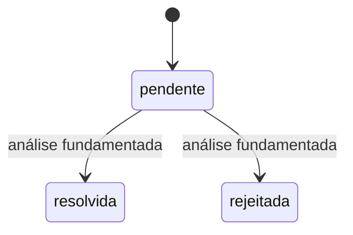

# Fase 11D — Denúncias e moderação de conteúdos

Implementação local para revisão, sem staging, commits, push, merge ou alteração de `main`. Sem início de fases posteriores, Swagger UI ou deployment Cloud.

## Requisitos e decisões

Foram lidos integralmente o relatório e as 47 linhas da matriz da auditoria 11.0. O PDF original foi consultado diretamente: página 4, moderação administrativa de avaliações e conteúdos; página 12, avaliações denunciadas. Rastreabilidade principal: **RF-AVA-02 / G08, P0**. Preservam-se RF-AUT-02/03, RNF-SEG-02, requisitos de catálogo/produtos e RNF-CON-01, sem alterar regras de leilões.

| Categoria                        | Âmbito                                                                                                                            |
| -------------------------------- | --------------------------------------------------------------------------------------------------------------------------------- |
| A — obrigatório explícito        | Denúncias e moderação administrativa de conteúdos.                                                                                |
| B — cumprimento parcial anterior | A Fase 9 já moderava avaliações; faltavam denúncias persistidas e supervisão de produtos/perfis.                                  |
| C — necessário para consistência | Autorização real, motivos, auditoria, ETag, paginação, visibilidade coerente, dados antigos e recuperação de resultados incertos. |
| D — opcional, excluído           | Estado «em análise», reabertura, automoderação, cancelamentos automáticos e notificações de denúncias.                            |

Q10/Q12 foram aprovadas expressamente pelo utilizador:

- Produtos, incluindo descrições/fotografias, perfis públicos de produtores e avaliações.
- Qualquer conta autenticada e ativa pode denunciar, independentemente do papel. Motivo obrigatório, uma denúncia por conta/conteúdo e ausência de ocultação automática.
- Produto oculto sai da descoberta e não admite novas compras ou novos leilões. Perfil oculto retira a loja pública e os seus produtos de novas compras. Conta, aprovação, gestão privada e obrigações existentes mantêm-se.
- Leilões existentes saem da descoberta pública e apresentam conteúdo neutro a compradores. Preço, prazo, ofertas, reservas, encerramento e vencedor são preservados. Sem cancelamentos automáticos.

Estas aprovações não resolvem outras pendências históricas fora do âmbito.

## Modelo e ciclo de vida

Coleção `content_reports`: autor, tipo/ID do alvo, motivo, evidência pública no instante da denúncia, estado, versão, datas e histórico. A evidência é imutável e administrativa; não inclui email, password, contactos privados, IBAN ou instruções privadas de pagamento.



Estados finais não são reabertos. Resolver/rejeitar uma denúncia **não altera a visibilidade**. Ocultar/restaurar é uma ação explícita separada; depois é necessário atualizar a denúncia antes de concluir a análise. `conteudoNaDecisao` preserva a visibilidade/versão nessa decisão, independentemente de restauros posteriores.

Produtos/perfis recebem `moderacao` opcional: `visivel`/`oculta`, versão e histórico. Ausência em dados antigos significa visível segundo a moderação. Publicação, aprovação, conta, stock e reservas permanecem separados. Restauro não publica rascunhos, reaprova produtores ou reativa contas.

Avaliações mantêm `publicada`/`oculta`, endpoints e histórico da Fase 9. As denúncias referenciam as avaliações existentes. O formato de auditoria e a guarda da conta foram extraídos para reutilização; não existe segundo sistema administrativo, de auditoria ou de autorização.

## Segurança, concorrência e recuperação

- JWT, conta ativa e papéis atuais são verificados no backend. Apenas administradores atuais decidem. Escritas revalidam a conta e usam a revisão operacional para serializar decisões com desativação/alterações concorrentes.
- O autor só consulta a própria denúncia de um alvo. Motivos administrativos e identidade do denunciante nunca são públicos. DTOs administrativos usam identificadores necessários à auditoria, sem contactos privados.
- Payloads estritos, IDs válidos, rejeição de query desconhecida/repetida. Motivo de denúncia 1–1000 caracteres; decisão 1–2000, normalizados NFC e aparados. Texto simples React, sem HTML executável. Imagens HTTP(S) sem credenciais, máximo duas, respeitando os limites existentes dos conteúdos.
- Criação: 12 tentativas/conta/minuto, 120/IP/minuto. Consulta própria: 120/conta/minuto, 240/IP/minuto. Administração reutiliza os limites existentes. Sem denúncia anónima ou ocultação baseada na contagem de denúncias.
- Transações MongoDB snapshot/majority/primary, CAS e revisão operacional. Estado, versão e auditoria são atómicos. Rollback não deixa auditorias parciais.
- `If-Match` forte obrigatório: 428 ausente, 400 inválido, 412 desatualizado. ETag da denúncia inclui a revisão do conteúdo atual, impedindo fechar uma análise com contexto antigo.
- Índice único autor/tipo/alvo impede duplicados inclusive simultâneos. Resposta perdida na criação: consultar a própria denúncia, sem repetir automaticamente o POST.
- Decisão incerta/conflito bloqueia novas escritas no cliente até consulta explícita. Não se promete repetir um PATCH com ETag antigo como sucesso idempotente.
- Até 1000 decisões de visibilidade por conteúdo; atingir o limite bloqueia a escrita sem apagar auditoria.

## Integração e preservação de regras

| Área                                 | Efeito                                                                                                                                                                                                                    |
| ------------------------------------ | ------------------------------------------------------------------------------------------------------------------------------------------------------------------------------------------------------------------------- |
| Catálogo, pesquisa, perfis, homepage | Novas consultas excluem produtos ocultos e produtos de perfis ocultos. Destaques de leilões respeitam a mesma descoberta REST.                                                                                            |
| Carrinho                             | A moderação não limpa a cesta. A reconciliação existente pode retirar linhas indisponíveis, com aviso, preservando as outras escolhas e a proteção de tentativas de checkout pendentes. O backend bloqueia novas compras. |
| Checkout                             | Produto/perfil são revalidados; revisões serializam a compra com ocultação. Recibos anteriores continuam recuperáveis.                                                                                                    |
| Encomendas e pagamentos              | Preservam snapshots, estados, receção e obrigações; sem cancelamento automático.                                                                                                                                          |
| Novo leilão                          | Produto/perfil ocultos não são elegíveis.                                                                                                                                                                                 |
| Leilão existente                     | Fora da descoberta, apresentação neutra para compradores. Ofertas, reserva, concorrência, prazo e vencedor seguem as regras existentes. Produtor/admin preservam snapshots privados.                                      |
| Avaliações                           | Ocultas saem da listagem/média; produtos ocultos deixam a média pública de avaliações de produtos do perfil. Média direta do produtor permanece separada.                                                                 |
| Fotografias locais                   | Novas leituras públicas verificam visibilidade. Proprietário da associação atual e administrador têm acesso privado autorizado pelo endpoint existente. Evidências não tornam imagens órfãs públicas.                     |
| Edição privada                       | Aviso de ocultação, gestão preservada. A edição não limpa a moderação; decisões invalidam ETags antigos.                                                                                                                  |

Não se retiram cópias já entregues a visitantes. Novas consultas respeitam a decisão; os destaques reconciliam pela API existente. Não foi criado um canal de moderação em tempo real nem prometida revogação instantânea de conteúdo carregado.

## API REST

Base `/api`, JSON e respostas privadas `Cache-Control: no-store`. Contrato completo em [openapi.yaml](openapi.yaml). Propostas bloqueadas `/reviews/:id/reports` e `/admin/review-reports` foram substituídas pelo contrato comum, sem aliases duplicados.

| Método e percurso                           | Finalidade                                       |
| ------------------------------------------- | ------------------------------------------------ |
| `POST /content-reports`                     | Criar, HTTP 201; 409 duplicado.                  |
| `GET /me/content-reports?alvoTipo=&alvoId=` | Consulta própria; `denuncia: null` se ausente.   |
| `GET /admin/content-reports`                | Filtros estado/tipo/ID exato, paginação MongoDB. |
| `GET /admin/content-reports/:id`            | Evidência, conteúdo atual e ETag.                |
| `PATCH /admin/content-reports/:id/decision` | Resolver/rejeitar com motivo e ETag.             |
| `GET /admin/content?tipo=produto\|produtor` | Visibilidade, ID e denúncias pendentes.          |
| `GET /admin/content/:tipo/:id`              | Conteúdo atual e ETag.                           |
| `GET /admin/content/:tipo/:id/history`      | Histórico paginado.                              |
| `PATCH /admin/content/:tipo/:id/moderation` | Ocultar/restaurar com motivo e ETag.             |

Paginação: `pagina` 1–1000, `porPagina` 12/24/36, `ordem` recentes/antigas. Sem pesquisa textual arbitrária de motivos privados. Erros estruturados existentes, sem detalhes internos. Moderação de avaliações usa exclusivamente `/admin/reviews/:id/moderation`.

## MongoDB e estrutura

`modules/moderation` separa tipos, schemas de auditoria reutilizados, modelo, validação, controlo de conta/ETag, serviço transacional, visibilidade de leilões e routers. Sem novas dependências.

Índices de denúncias: único autor/tipo/alvo; estado/tipo/data/ID; alvo/estado; data/ID. Produtos/perfis recebem índice aditivo moderação/data/ID. Filtragem e paginação na base de dados. Sem migrações destrutivas ou atualização massiva de dados antigos.

Os três testes anteriores de inventário de índices foram atualizados para verificar explicitamente o novo índice, mantendo todas as verificações de unicidade, coleções e índices anteriores. Não foram enfraquecidos testes financeiros ou de concorrência.

## Interface e revisão

Denúncia em produto, perfil e avaliação pública, com autenticação, motivo, confirmação, consulta própria e recuperação. Cartões próprios/administrativos não recebem ações públicas redundantes.

Na área existente `/area/administrador/moderacao`: separadores Avaliações, Denúncias, Produtos e Perfis; listas, filtros, paginação, detalhe, evidência original/atual, decisão e auditoria. Gestão privada informa da ocultação sem expor motivos administrativos. Destinos pós-login aceitam apenas novos percursos internos válidos e papéis adequados; destinos externos continuam recusados.

Componentes e tokens reutilizam a identidade editorial. Revisão real nas seis larguras 320/430/768/1024/1280/1440: produto/denúncia, perfil/formulário, lista administrativa, denúncia e conteúdo. Verificações de overflow, erros JavaScript, contraste calculado, labels, confirmação, foco, Tab, Escape e devolução de foco. Capturas e medições ficam fora do Git, na pasta temporária do relatório final.

**VoiceOver audível não foi verificado neste ambiente.** Contraste calculado e árvore acessível não constituem certificação WCAG.

## Testes e validação

Testes novos unitários, HTTP/MongoDB, contratos/UI React e integrações reais React/API/MongoDB cobrem duplicados, abuso, autorização atual, contas desativadas, privacidade, conflitos, auditoria única, rollback, fotografias, edição privada, compras e leilões existentes. Suites anteriores são preservadas. Fixtures históricas e contas fictícias existem apenas em bases efémeras de teste.

```sh
npm run test --workspace @docampo/api
npm run typecheck --workspace @docampo/api
npm run typecheck
npm run lint
npx prettier --check --ignore-path .prettierignore README.md apps packages docs/api docs/design
npm run build --workspace @docampo/api
npm run build
npx playwright test --workers=1
npx playwright test --config playwright.integration.config.ts
npx playwright test --config playwright.auctions.config.ts
git diff --check
```

Prettier executa na raiz com ignore explícito, excluindo `dist`, dependências e artefactos. Suites reais usam replica set isolado e base `docampo_test_web_*` removida pelo runner. Contagens efetivamente executadas, capturas, inventário e problemas corrigidos constam do relatório final; mocks não são apresentados como integração real.

### Resultados finais — 02-11-2026

| Validação executada                                | Resultado                                                                                                         |
| -------------------------------------------------- | ----------------------------------------------------------------------------------------------------------------- |
| Backend completo                                   | 1923 aprovados: 1870 anteriores e 53 novos (20 unitários e 33 HTTP/MongoDB).                                      |
| Frontend habitual completo                         | 661 aprovados, incluindo 11 novos testes de contratos/interface.                                                  |
| Integração React/API/MongoDB completa              | 182 aprovados, incluindo 13 novos cenários de moderação.                                                          |
| Carrinho real, verificação adicional               | 1 aprovado, acrescentado depois da suite completa; restantes resultados válidos para o mesmo código da aplicação. |
| Regressão dedicada de leilões                      | 12 aprovados.                                                                                                     |
| Total distinto                                     | 2779; execuções focadas repetidas não são contadas novamente.                                                     |
| TypeScript API/frontend, ESLint, Prettier e builds | Aprovados.                                                                                                        |
| OpenAPI e ligações Markdown                        | Aprovados; contratos implementados anteriores preservados.                                                        |
| Fase 0 e dependências                              | Nove documentos e dependências intactos.                                                                          |

Foram produzidas 30 capturas, cinco páginas em cada uma das seis larguras. Sem overflow ou erros JavaScript nos cenários revistos; contraste calculado mínimo de 5,24:1 nos elementos analisados. Teclado, confirmação e devolução de foco aprovados. Não constitui certificação WCAG nem avaliação audível do VoiceOver.

Durante a preparação, uma leitura de leilão devolveu HTTP 503; não se reproduziu no diagnóstico isolado nem nas suites finais. A causa não foi demonstrada e não se atribui automaticamente ao desfasamento de relógios anteriormente documentado. Mantém-se o tratamento seguro de indisponibilidade. Uma execução frontend intermédia, realizada enquanto ainda havia edições, falhou com um campo de formulário vazio e foi interrompida; a execução final completa decorreu com os ficheiros estabilizados e passou. Um novo teste de moderação de avaliações foi sincronizado com a página de destino, sem alterar testes antigos para esconder regressões.

## Revisão visual reproduzível

Pode reutilizar-se o ambiente de revisão existente de avaliações, que cria apenas contas fictícias e uma base MongoDB efémera. Depois de iniciar o replica set de teste, em terminais separados, na raiz:

```sh
npm run mongo:test:up --workspace @docampo/api
DOCAMPO_REVIEWS_REVIEW=1 node --import tsx apps/web/tests/support/real-api-server.mjs
```

```sh
VITE_API_URL=http://127.0.0.1:3011/api npm run dev --workspace @docampo/web -- --port 5183
```

O servidor indica o caminho do ficheiro privado de contas fictícias. Usar os respetivos IDs em `/produtos/:id` e `/produtores/:id` para denunciar; entrar com a conta administrativa para rever `/area/administrador/moderacao/denuncias`, `/produtos` e `/perfis` dentro da mesma área. Avaliações continuam no separador existente. Após ocultar/restaurar, atualizar a consulta pública ou o leilão para confirmar o estado persistido. Não usar dados de produção. Ctrl+C no servidor remove a sua base e o ficheiro de contas; o MongoDB de teste pode depois ser parado sem eliminar volumes.

## Limitações e pendências

- Sem denúncia anónima, repetição da mesma conta/conteúdo, reabertura, automoderação ou notificações. Unicidade permanente nesta fase.
- Visibilidade e encerramento são comandos separados com contexto/ETag; não é prometida transação única entre os dois.
- Rate limiting mantém o adaptador em memória existente; coordenação distribuída fica para deployment.
- Adaptador local de imagens exclusivo de desenvolvimento. Cloud, limpeza de órfãos e retenção/expurgo de evidências continuam pendentes; sem eliminação silenciosa.
- Sem retirada de cópias já descarregadas ou cancelamentos automáticos. VoiceOver audível e processos organizacionais de recurso exigem revisão posterior.
- Restantes lacunas da auditoria, Swagger UI, Cloud e fases seguintes não foram iniciados.

## Preparação Git

Proposta, sem executar: `feat(moderation): add content reporting and admin review`. Destino futuro `origin/feat/api-foundation`, mediante nova autorização. Nove documentos originais da Fase 0 preservados.
