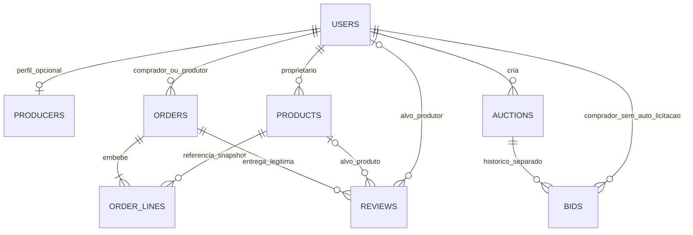

# Fase 3.2 — consolidação documental dos modelos MongoDB

> Estado vigente após nova aprovação: O01–O16 e OR01–OR12 aprovadas; orders pronto documentalmente para persistência isolada, aguardando autorização de implementação. Ver [consolidação vigente](phase-3.2-orders-readiness.md). Recomendações/pedidos de aprovação das revisões anteriores são históricos e não reabrem estas decisões.

**Estado: T32-01–T32-06 aprovadas no âmbito explícito; A01–A03 aprovadas e primeiro bloco users/producers implementado localmente; products posteriormente autorizado/implementado com P01–P08; restantes quatro modelos não autorizados.** Consolidação em 2026-10-17, após preparação em 2026-10-16 na branch `feat/api-foundation`, HEAD `68f41ec`, após publicação da fundação. Main permanece em `c10d031`. A preparação inicial era documental; a autorização posterior abrangeu apenas os dois modelos, validações, índices e testes, conforme a [entrega do primeiro bloco](phase-3.2-identity-implementation.md). C04 mantém todas as operações privadas inacessíveis até à segurança real da semana 4.

Este documento complementa [decisions.md](decisions.md), [modelos detalhados](phase-3.2-models.md), [correspondência de dados](data-mapping.md), [segurança](security.md), [OpenAPI](openapi.yaml), [integração futura](frontend-integration.md) e [plano](implementation-plan.md). A [entrega 3.1](foundation-implementation.md) é evidência histórica; os ajustes seguintes não alteram a implementação publicada.

## 1. Fontes e autoridade

Foram consultados os nove documentos originais da Fase 0, preservados integralmente: [funcionais](../requirements/functional-requirements.md), [não funcionais](../requirements/non-functional-requirements.md), [casos de utilização](../requirements/use-cases.md), [visão global](../architecture/system-overview.md), [diagramas](../architecture/architecture-diagram.md), [consistência dos leilões](../architecture/auction-consistency.md), [decisões originais](../architecture/decisions.md), [modelo original](../database/data-model.md) e [plano oficial](../planning/implementation-plan.md).

Consultado o PDF académico de 27 páginas, SHA-256 `ff42084c30a5a663ce4165ae301c5255dd313f710e51af446fd5dbffe3925243`, sem o copiar para o repositório. Páginas 4/9–12: funções; 17: REST; 18: cinco coleções, embedding/referências e validação; 20: segurança; 21: consistência dos leilões. As escolhas novas do utilizador prevalecem sobre recomendações antigas, sem reescrever F0.

| Classe | Significado nesta proposta                                                                                                                                                                                                      |
| ------ | ------------------------------------------------------------------------------------------------------------------------------------------------------------------------------------------------------------------------------- |
| O      | Obrigação académica: users/products/orders/auctions/bids; linhas embebidas e comprador/produtor referenciados; required/enum/min; consulta com pelo menos um operador indicado em E p. 18; funções e segurança correspondentes. |
| A      | Aprovação explícita: C01/C02/C04/C06 o âmbito funcional de Q01/Q03/Q04/Q06/Q14 e T32-01–T32-06 nos limites do registo abaixo.                                                                                                   |
| P      | Recomendação técnica para aprovação: nomes concretos de campos, tipos BSON, índices, limites, arredondamento, coleções adicionais e etapas.                                                                                     |
| B      | Bloqueado: depende de Q ainda pendente ou detalhe técnico residual ainda não aprovado. Não preencher a lacuna com um default comercial.                                                                                         |

Não confundir «campo obrigatório no modelo proposto» com «campo literalmente exigido pelo enunciado». As tabelas de modelos explicitam ambos.

## 2. Cinco decisões funcionais aprovadas

| ID  | Âmbito aprovado agora                                                                                                                                                                                                                                                                | Mantém-se por decidir                                                                                                                                                       |
| --- | ------------------------------------------------------------------------------------------------------------------------------------------------------------------------------------------------------------------------------------------------------------------------------------ | --------------------------------------------------------------------------------------------------------------------------------------------------------------------------- |
| Q01 | A mesma conta pode comprar e produzir, acedendo às duas áreas; venda depende de candidatura aprovada; impedir auto-licitação por identidade; administrador apenas por procedimento controlado, sem registo público.                                                                  | Lista de papéis aprovada por T32-01; aquisição de capacidade produtor, claims futuros e provisionamento administrativo continuam pendentes. Papel único ultrapassado.       |
| Q03 | Venda à unidade, por embalagem, ao peso e por volume; modalidade adequada definida pelo produtor; quantidades fracionadas no domínio misto.                                                                                                                                          | T32-02 aprova inteiros em g/ml/unidades/embalagens; T32-03 aprova half-up por linha. Mínimos/passos, limites, referência de preço, BSON e DTO concreto continuam pendentes. |
| Q04 | Pendente pode consultar candidatura, editar perfil e criar/editar rascunhos; não publica, recebe encomendas ou cria leilões. Aprovado gere/publica/vende/cria leilões. Aprovação não publica rascunhos automaticamente. Rejeitado consulta decisão/justificação e não publica/vende. | Recandidatura; permissões adicionais do rejeitado sobre rascunhos/perfil; conteúdo mínimo de um rascunho; políticas de reabertura/revogação não foram aprovadas.            |
| Q06 | EUR, preços em cêntimos inteiros; pagamento direto ao produtor, sem pagamento eletrónico; servidor calcula totais; preço alterado exige reconfirmação antes de concluir.                                                                                                             | Preço zero, entrega/recolha, encargos, dados, reconfirmação e agregação de linhas pendentes; half-up por linha aprovado em T32-03. Não inventar estado «pago».              |
| Q14 | Categoria principal predefinida; etiquetas personalizadas; ingredientes quando aplicável; sazonalidade; pesquisa com/sem acentos.                                                                                                                                                    | Meses opcionais aprovados por T32-04; lista final/IDs, limites, modo de produção e C03 pendentes. Não oficializar categorias dos mocks.                                     |

**Continuam pendentes:** Q02, Q05, Q07, Q08, Q09, Q10, Q11, Q12, Q13, Q15, Q16 e C03/C05. Permanecem também os detalhes residuais acima e propostas D06/D07/D08 não adotadas expressamente e campos/índices D09 residuais. Aprovar esta documentação não autoriza implementar os modelos.

## 3. Conta, perfil e capacidades

**Aprovado T32-01:** lista de papéis na conta, com acumulação comprador/produtor e perfil separado. `users.papeis` concretiza essa lista na proposta. Flags exclusivas ou papel único deixam de ser alternativas vigentes. `producers.userId` com unicidade e os demais detalhes físicos do primeiro bloco foram confirmados em A01/A02 na [análise de prontidão](phase-3.2-readiness.md).
A permissão efetiva de vender exige identidade autenticada, capacidade produtor, perfil próprio e aprovação atual. Ter `produtor` no array não significa aprovação. A possibilidade de comprar não depende da aprovação comercial do perfil; Q01 permite usar a mesma conta nas duas áreas. Não atribuir ambos os papéis indiscriminadamente no registo: definir o fluxo de solicitação da capacidade produtor e eventual criação conjunta de conta/perfil antes da segurança real.

Impedir auto-licitação comparando `bid.comprador` com `auction.produtor`, ambos referências à mesma coleção users. Não comparar apenas o papel/contexto ativo ou o ID público do perfil. A proposta não cria uma proibição adicional de comprar o próprio produto fora dos leilões: tal regra não foi aprovada.

Administrador não é valor aceite do cliente nem resultado de aprovar candidatura. Não pressupor que uma conta administrativa também tem capacidades comerciais: a combinação e o mecanismo de atribuição ficam controlados e por detalhar, sem novo endpoint de permissões.

## 4. Quantidades — inteiros em unidades mínimas aprovados

| Aspeto           | A — decimais com precisão controlada                                                                                                                                  | B — inteiros em unidades mínimas                                                                                                                                    |
| ---------------- | --------------------------------------------------------------------------------------------------------------------------------------------------------------------- | ------------------------------------------------------------------------------------------------------------------------------------------------------------------- |
| Exemplo          | `"0.250" kg`, armazenado em Decimal128 ou decimal exato equivalente.                                                                                                  | `250 g`; embalagem: `2 unidades comerciais`, conteúdo separado `500 g` por embalagem.                                                                               |
| Precisão         | Definir escala por dimensão e validar a cadeia antes de criar Decimal128. Não calcular usando Number binário ou converter Decimal128 indiscriminadamente para Number. | Inteiros exatos dentro de intervalo aprovado; gramas/ml são resolução aprovada em T32-02. Prever BigInt nos cálculos intermédios.                                   |
| Vantagens        | Próximo da apresentação em kg/litros; acomoda escalas adicionais.                                                                                                     | Débito de stock, comparação e verificação de passos ficam simples; sem biblioteca decimal adicional por omissão.                                                    |
| Custos           | Aritmética decimal no Node precisa de estratégia própria, eventualmente biblioteca a aprovar; serialização do DTO e arredondamento continuam necessários.             | Conversão explícita de rótulos e entradas; resolução deve cobrir produtos reais; limites de inteiros e JSON têm de ser verificados.                                 |
| MongoDB/Mongoose | Decimal128 é suportado, mas não fornece automaticamente toda a aritmética Node. JSON deve transportar valor exato como string ou objeto explicitado.                  | Number restrito a inteiros seguros é uma opção; BigInt de Mongoose guarda BSON long e exige adaptador JSON. Tipo físico e limites são detalhes residuais de T32-02. |
| Falha a evitar   | `parseFloat("0,25")`, doubles aproximados e arredondar após cada conversão.                                                                                           | Tratar 500 g de conteúdo como 500 embalagens, misturar g com ml ou exceder a precisão segura do Number.                                                             |

**Decisão T32-02 aprovada:** abordagem B, inteiros em gramas, mililitros, unidades inteiras ou número de embalagens; interface em kg/L/unidades/embalagens. A comparação acima preserva a fundamentação histórica; Decimal128 para quantidades deixa de ser uma alternativa pendente. A aprovação não escolhe Number seguro versus BSON long, limites ou campos concretos do DTO. A documentação MongoDB apresenta decimal e escala inteira como possibilidades; a recomendação B para quantidades é específica deste domínio e não atribui ao MongoDB preferência geral por esta escolha. Dinheiro mantém cêntimos inteiros por decisão Q06, independentemente da escolha de quantidade.

### 4.1 Estrutura candidata para a representação B aprovada

`unidadeVenda` embebida propõe: `modalidade` (unidade/embalagem/peso/volume), `unidadeBase` (un/g/ml), `quantidadeReferencia`, `quantidadeMinima`, `incrementoCompra`, `rotulo` e `conteudoPorUnidade` opcional (quantidade/unidade). `precoCent` é preço por `quantidadeReferencia`, não necessariamente por 1 g/ml. Stock e quantidade da linha usam a unidadeBase; a linha guarda um snapshot completo da unidade/preço. Todos estes nomes e códigos são P.

| Produto ilustrativo                | Modalidade/base | Referência do preço        | Conteúdo da embalagem | Exemplo de compra / total exato antes de arredondar   |
| ---------------------------------- | --------------- | -------------------------- | --------------------- | ----------------------------------------------------- |
| Produto à unidade, 200 cêntimos    | unidade / un    | 1 un                       | Não necessário.       | 3 un → 600 cêntimos.                                  |
| Batatas, 1,50 €/kg                 | peso / g        | 1000 g → 150 cêntimos      | Não aplicável.        | 250 g → 37,5 → 38 cêntimos, half-up aprovado.         |
| Morangos, embalagem 500 g a 3,50 € | embalagem / un  | 1 embalagem → 350 cêntimos | 500 g por embalagem.  | 2 embalagens → 700 cêntimos; stock baixa 2, não 1000. |
| Ovos, caixa de 6 a 3,00 €          | embalagem / un  | 1 caixa → 300 cêntimos     | 6 un por caixa.       | 2 caixas → 600 cêntimos, conteúdo 12 ovos.            |
| Azeite, garrafa 750 ml a 7,00 €    | embalagem / un  | 1 garrafa → 700 cêntimos   | 750 ml por garrafa.   | 2 garrafas → 1400 cêntimos; não cobrar 2 litros.      |
| Líquido a granel, exemplo 2,00 €/l | volume / ml     | 1000 ml → 200 cêntimos     | Não aplicável.        | 250 ml → 50 cêntimos.                                 |

Não escolher automaticamente mínimos/passos do produtor. Um exemplo proposto seria mínimo 250 g/passo 50 g para peso e mínimo/passo 1 para embalagens. A regra candidata de alinhamento é `quantidade >= minimo` e `(quantidade - minimo) % incremento == 0`; confirmar a origem do alinhamento antes de implementar. Stock livre pode ficar abaixo do mínimo ou fora da grelha após operações: não o tornar vendável por arredondamento. Só oferecer uma quantidade que cumpra grelha e stock.

Conversões propostas: kg↔g e l↔ml por fator 1000, apenas dentro da mesma dimensão; unidade comercial↔conteúdo serve apresentação/composição, não permite vender frações de uma embalagem por inferência. Recusar perda de resolução em vez de truncar silenciosamente. Entrada portuguesa `0,25` pode ser convertida textualmente para a representação canónica; separadores de milhar, sinais e casas permitidas precisam de regra antes da implementação. Não converter peso em volume sem dados e regra explicitamente aprovados. O min:1 do exemplo académico de E p. 18 não impõe uma compra mínima de 1 kg: a validação min deve respeitar a unidade/escala aprovada, sem contrariar as frações admitidas por Q03.

### 4.2 Precisão, preço e snapshots

Fórmula candidata para B: `subtotalExatoCent = precoCent × quantidadeBase / quantidadeReferencia`. Multiplicar/dividir racionalmente com inteiros, guardando quociente/resto, evita erro binário. Se usar Number no armazenamento, impor inteiro seguro em cada operando/resultado e limites comerciais menores a aprovar; um produto intermédio pode ultrapassar o intervalo mesmo com operandos válidos, pelo que se recomenda BigInt interno ou aritmética exata equivalente. Não enviar BigInt cru em JSON.

**T32-03 aprovado:** calcular cada subtotal com precisão exata e aplicar half-up ao cêntimo; total = soma dos subtotais já arredondados, com o servidor como fonte de verdade e sem ponto flutuante impreciso. Exemplo: 250 g a 150 cêntimos/1000 g dão 37,5 → **38 cêntimos**. A agregação de linhas iguais, limites e versão da referência de preço continuam propostas. Recomenda-se agrupar o mesmo produto/referência/versão para evitar diferenças por fragmentação, sem considerar essa agregação aprovada.

Encomenda guarda quantidade, preço por referência, unidade/conteúdo e subtotal já calculado; o histórico não é recalculado após mudar produto. A alteração de referência/unidade num produto com histórico exige uma política de versão e migração de stock/formulários, proposta a confirmar. Não reclassificar 20 embalagens como 20 g.

Leilão guarda quantidade física/comercial e snapshot da unidade do lote; `valorCent` de uma bid continua o preço total oferecido pelo lote. Não multiplicar a oferta pelo peso nem inventar reserva/conversão Q07. O conteúdo físico de uma eventual linha «lote» e a sua quantidade comercial de cobrança não são intercambiáveis.

## 5. Categoria, etiquetas, ingredientes e sazonalidade

A lista inicial sugerida foi substituída pelas **doze categorias aprovadas P01**, com códigos técnicos estáveis cat-001–cat-012; rótulo de cat-004 «Pão e padaria» e cat-012 «Outros produtos locais». Ver [lista integral e constantes efetivas](phase-3.2-products.md). Nenhuma coleção de categorias adicional.

Uma categoria principal obrigatória na publicação; P04 permite rascunho sem categoria. Etiquetas complementam, não substituem categoria nem provam certificação biológica. Detalhes residuais de T32-04, ainda propostos: até 10 etiquetas, 40 caracteres Unicode por rótulo, deduplicadas pela forma normalizada; até 30 ingredientes, 80 caracteres cada. Estes números não vêm do enunciado nem ficam aprovados por aparecerem aqui. Definir rótulo NFC, trim e espaços consolidados; chave de pesquisa minúscula, sem marcas diacríticas e espaços normalizados. Evitar HTML ativo e nomes de campos arbitrários vindos do cliente.

Ingredientes são termos explícitos quando aplicáveis; ausência não significa declaração de inexistência de ingredientes/alergénios. Propor array de `{rotulo, normalizado}` em etiquetas/ingredientes e campos derivados pelo servidor. Não aceitar `normalizado` arbitrariamente como autoridade do cliente.

**T32-04 aprovado:** sazonalidade opcional por meses; informação sem efeito automático na disponibilidade. Meses 1–12 são a concretização proposta no contrato, sem obrigação de informar a época. Estações e intervalos de datas deixam de ser alternativas em aberto para esta representação. Recomenda-se ausência como não informada; semântica de lista vazia e mapeamento das estações dos mocks continuam residuais. Não preencher 12 meses por omissão nem inferir meses de createdAt. Categoria principal é obrigatória e controlada; etiquetas opcionais; ingredientes quando aplicável; pesquisa ignora caixa e acentos. A lista e os limites acima não foram aprovados.

Pesquisa: normalizar tanto a consulta como nomes/etiquetas/ingredientes/localidade; resolver nome/localidade de perfis aprovados para IDs users e depois filtrar products. Recomendação inicial de regex escapada sobre campos normalizados e com comprimento limitado (proposta: 100 caracteres), combinando critérios por AND; OR apenas entre campos pesquisáveis do termo. Categoria/etiquetas exatas usam chaves controladas; preço mantém cêntimos. Comparar preço de kg com preço de embalagem sem equivalência pode ser enganador: semântica do filtro de preço por referência precisa de C03/T32-02 antes da integração.

Índices candidatos: escalar categoria/produtor/estado; índices separados para cada array de etiquetas/ingredientes/meses. Não compor dois arrays paralelos no mesmo índice. Regex de substring normalizada não fica automaticamente eficiente por criar um índice; medir com explain/dados na fase autorizada e não instalar Atlas Search/Elasticsearch agora. Collation não substitui automaticamente pesquisa regex sem acentos.

## 6. Aprovação, rascunhos e acesso futuro

| Estado do perfil | Consulta candidatura                  | Editar perfil                                 | Criar/editar rascunhos                        | Publicar/vender/receber novas encomendas          | Criar leilão              |
| ---------------- | ------------------------------------- | --------------------------------------------- | --------------------------------------------- | ------------------------------------------------- | ------------------------- |
| pendente         | Sim, própria.                         | Sim, campos próprios permitidos.              | Sim, próprios.                                | Não.                                              | Não.                      |
| aprovado         | Sim, própria.                         | Sim.                                          | Sim.                                          | Sim, com publicação explícita e restantes regras. | Sim, respeitando Q07/Q08. |
| rejeitado        | Sim, decisão e justificação próprias. | Não atribuir permissão adicional sem decisão. | Não atribuir permissão adicional sem decisão. | Não.                                              | Não.                      |

Na conta acumulada, capacidades de comprador continuam avaliadas pela identidade/capacidade de compra, não pelo estado comercial do perfil. Toda esta matriz é alvo futuro: nenhuma destas operações privadas fica acessível agora. Aprovar perfil nunca altera rascunhos automaticamente. Produto público exige estado publicado e perfil atual aprovado, não apenas um indicador guardado no produto.

**T32-05 aprovado:** produto inicia em rascunho; estados exclusivos rascunho/publicado/arquivado. Publicação exige ação explícita de produtor aprovado; aprovação administrativa não publica. Publicado com stock zero pode continuar visível como esgotado, sem compra: esgotado é disponibilidade derivada, não quarto estado. Arquivo retira da venda e preserva histórico. P04 permite rascunho apenas com nome editável, sem categoria obrigatória; define os campos completos de publicação. Restauro, detalhe público do arquivado e remoção continuam pendentes. A estrutura de decisão/justificação do perfil é distinta dos estados de produto; foi aprovada separadamente em A03 e implementada no bloco de identidade, sem endpoints.

## 7. Relações e integridade

ProducerProfile é um perfil, não uma segunda conta. `products.produtor`, `orders.comprador/produtor`, `auctions.produtor` e `bids.comprador` referenciam users; o DTO público produtorId resolve o ID de perfil. O mesmo user pode aparecer como comprador numa encomenda e produtor noutra. Não duplicar utilizadores por contexto de navegação.

Embeber unidade, conteúdo, imagens como metadados, aprovação e linhas de encomenda: pequenos dados lidos juntos ou snapshots históricos. Referenciar users/produtos/perfis e manter bids/reviews separados: entidades partilhadas ou histórico com crescimento próprio. Arrays de denúncias/histórico exigem limites e política, não crescimento ilimitado por omissão. Bytes de imagens ficam para Blob na fase própria.

ObjectId/ref não cria foreign key. Required/enum/min verificam forma local; serviço verifica existência, propriedade, perfil/aprovação e alvo de review. Índices únicos verificam conflitos reais; não substituem permissões. Normalização e campos derivados devem ser mantidos em todas as vias de escrita. Validadores de update têm limitações, sobretudo para operações como `$inc`; stock condicionado e validação cruzada não se resumem a runValidators.

Preparar interfaces de sessão/serviços para futuras transações sem as implementar: criação consistente de conta/perfil se esse fluxo for aprovado; encomendas/stock dependem Q02/Q05 e D08; auction+bid depende D06/Q07/Q08. Emitir eventos só após confirmação. Não inserir dados comerciais, ativar índices, reservar stock ou simular fluxo de autenticação nesta preparação.

## 8. Compatibilidade com o contrato e frontend

O [OpenAPI](openapi.yaml) mantém 45 operações: só getHealth está implementado; as outras 44 continuam bloqueadas. Documenta lista de papéis, quantidades inteiras nas unidades mínimas, half-up, meses opcionais e estados aprovados, sem criar endpoints. SaleUnit passa a forma candidata alinhada com os modelos, ainda marcada para revisão: campos/required da referência de preço, limites e comandos não foram aprovados em bloco. O DTO privado de rascunho/publicação deve refletir P04, com criação só com nome e campos de publicação condicionais, antes dos endpoints.

| Ponto                            | Compatibilidade e trabalho futuro                                                                                                                                                            |
| -------------------------------- | -------------------------------------------------------------------------------------------------------------------------------------------------------------------------------------------- |
| UserSelf/UserSummary.papel único | `papeis[]` aprovado por T32-01; aquisição de capacidades e combinações administrativas ficam para a segurança real.                                                                          |
| Registration.papel               | Campo legado proposto como preferência inicial, não exclusividade/capacidade efetiva; rever contrato de aquisição de capacidade produtor antes da semana 4. Nunca aceitar admin.             |
| ProductWrite/Replace             | Rascunho e publicação precisam de campos mínimos e intenção explícita acordados; não permitir publicar só por guardar. DTO público completo não representa automaticamente rascunho parcial. |
| Quantity/SaleUnit/stock          | Quantity/stock passam a inteiros; g/ml/unidades/embalagens aprovados. SaleUnit alinha campos candidatos aos modelos e mantém revisão de referência/required/limites/DTO.                     |
| precoCent/moeda                  | Cêntimos/EUR/half-up por linha aprovados; zero e limites ainda pendentes.                                                                                                                    |
| categoria/etiquetas/epocaMeses   | Categoria obrigatória, etiquetas opcionais e meses opcionais informativos aprovados; cat-001..011 não entram como enum oficial.                                                              |

Frontend observado: ProductCategory tem oito rótulos; Product.unit é texto e availableStock inteiro; CartItem.quantity e validação do carrinho só aceitam inteiros seguros; subtotal multiplica quantidade pelo preço sem referência física. DemoSession/AdminUser guardam um único role. ProducerDataset representa candidatura pendente e produtos demonstrativos sem ciclo de publicação real. Portanto, a nova modelação não é uma simples troca de nomes.

Na integração futura: preservar modo demo e 274 testes; obter identidade/capacidades reais separadamente; mudar apresentação por contexto sem trocar conta; converter categorias por ID/rótulo, preços por referência e quantidades pela unidade escolhida; prever versão/migração explícita de `docampo.cart.v1` e reconfirmação de preço/unidade. Não apagar carrinho em loading/erro ou reinterpretar antigas quantidades. Indicadores não somam g, ml e embalagens como se fossem a mesma grandeza; distinguir conta única de número de capacidades e produtor registado de aprovado. O limiar/fórmula continuam Q15. Nenhum desses ficheiros é alterado agora.

## 9. Plano de implementação futuro, por aprovação separada

Os caminhos seguintes ficam sob `apps/api`; os modelos users/producers e products, apoio de validação e respetivos testes já foram criados, conforme as entregas. Os caminhos históricos sugeridos na tabela podem diferir dos ficheiros efetivos ligados na entrega products; restantes caminhos continuam previsões. Preservar `src/config`, `src/database`, `src/http` e runtime existentes. Não abrir rotas privadas. Não instalar dependências por esta proposta.

| Etapa | Objetivo / modelos                                            | Ficheiros previstos                                                                                                                    | Dependências e pendências                                                                                | Testes futuros / aceitação                                                                                                                                                                                                                                       | Riscos                                                                                                    |
| ----- | ------------------------------------------------------------- | -------------------------------------------------------------------------------------------------------------------------------------- | -------------------------------------------------------------------------------------------------------- | ---------------------------------------------------------------------------------------------------------------------------------------------------------------------------------------------------------------------------------------------------------------- | --------------------------------------------------------------------------------------------------------- |
| 3.2.a | Fechar representações e contrato, sem persistência comercial. | Documento complementar e, só após autorização, `src/modules/shared/{quantities,money,categories}.ts`, tipos/validação próprios da API. | A01–A03 para identidade; representações comerciais residuais antes de Product, sem atrasar User/perfil.  | Exemplos de unidade/embalagem/peso/volume inequívocos, conversões exatas, limites testáveis; não declarar esta etapa já executada.                                                                                                                               | Confundir aprovação funcional com escolha de codificação.                                                 |
| 3.2.b | User e perfil/aprovação.                                      | `src/modules/users/user.model.ts`, `src/modules/producers/producer.model.ts`; `tests/models/identity.spec.ts`.                         | A01/A02/A03 da análise de prontidão; sem sessão, serviços de registo ou decisão administrativa.          | MongoDB real: required, enums, capacidades duplicadas, email/perfil único, limites da validação local e privacidade; referências e rollback ficam para o serviço futuro autorizado.                                                                              | Introduzir JWT/bcrypt ou admin de teste por rota; seed comercial antes de autorização.                    |
| 3.2.c | Product, unidade e categoria/rascunho.                        | `src/modules/products/{product.model,product.validation}.ts`, `tests/models/products.spec.ts`.                                         | T32-02..06 aprovadas no âmbito do registo, detalhes residuais; Q06 residual, Q12/Q15 onde afetem campos. | MongoDB real: stock/preços inválidos, grelha, overflow, unidades incompatíveis, categoria/etiquetas, pendente com rascunho válido e publicação bloqueada no serviço.                                                                                             | Validator não protege `$inc`; enum copiar mocks; requisição parcial apagar stock.                         |
| 3.2.d | Order com linhas/snapshots.                                   | `src/modules/orders/order.model.ts`, `tests/models/orders.spec.ts`, fixtures de teste isoladas se autorizadas.                         | Q02/Q05/Q06 residual; D08 só se adotado; representação e arredondamento.                                 | Referências users/produtos, linhas não vazias/coerentes, snapshots após edição, preços/total adulterados, isolamento/rollback aplicável.                                                                                                                         | Inventar entrega/cancelamento, debitar stock nesta etapa sem regras, múltiplos produtores inconsistentes. |
| 3.2.e | Auction/Bid, sem licitar ou agendador.                        | `src/modules/auctions/{auction,bid}.model.ts`, `tests/models/auctions.spec.ts`.                                                        | Q07/Q08/Q09/Q12; D06/D07 para campos/índices dependentes.                                                | Enums/datas/referências; base sem bid/vencedor; impedir auto-licitação no serviço futuro; índices aprovados e ensaio transacional interno se autorizado.                                                                                                         | Término por TTL, preço base como bid, reserva/conversão presumidas.                                       |
| 3.2.f | Review em coleção aprovada; política pendente.                | `src/modules/reviews/review.model.ts`, `tests/models/reviews.spec.ts`.                                                                 | Coleção aprovada T32-06; Q10/Q12 antes dos campos/índices; sem escala/unicidade automática.              | Ambos os alvos, exatamente um alvo válido, entrega própria, visibilidade/evidência e índices condicionais segundo decisão.                                                                                                                                       | Tornar o 1–5 dos mocks regra por inferência ou perder denúncias.                                          |
| 3.2.g | Consolidar índices/integridade e regressão.                   | `tests/models/integrity.spec.ts`, documentação de índices e evidências; nenhum script destrutivo genérico.                             | Todas as escolhas aplicáveis aprovadas; implementação autorizada das etapas anteriores.                  | Criar/aguardar índices explicitamente na base efémera porque autoIndex está false; duplicados/conflitos concorrentes; referência inválida recusada pelo serviço; transações em MongoDB real; 49 backend + 274 Playwright preservados e novos testes pertinentes. | syncIndexes/dropDatabase fora do ensaio próprio; declarar segurança concluída sem semana 4.               |

As cinco coleções são obrigatórias no projeto final; decisões pendentes podem impedir implementar partes agora, não autorizam omiti-las do produto final. A criação de uma coleção para teste futuro não implica publicação de endpoints ou introdução de dados em desenvolvimento.

## 10. Decisões técnicas aprovadas e limites residuais

| ID     | Âmbito aprovado em 2026-10-17                                                                                                                   | Continua pendente                                                                                                   |
| ------ | ----------------------------------------------------------------------------------------------------------------------------------------------- | ------------------------------------------------------------------------------------------------------------------- |
| T32-01 | Lista de papéis; comprador/produtor acumuláveis; perfil separado; vender depende de aprovação.                                                  | Aquisição/provisionamento, claims e concretizações A01/A02.                                                         |
| T32-02 | Inteiros em g/ml/unidades/número de embalagens; kg/L na apresentação; embalagem distinta do conteúdo.                                           | Tipo BSON, limites, referência de preço, mínimos/passos, DTO e validação da entrada.                                |
| T32-03 | Subtotal exato por linha, half-up, soma das linhas arredondadas, cálculo no servidor sem ponto flutuante impreciso.                             | Agregação de linhas iguais, limites e versionamento/reconfirmação de referência de preço.                           |
| T32-04 | Categoria controlada obrigatória, etiquetas opcionais, ingredientes aplicáveis, meses opcionais informativos, pesquisa sem caixa/acentos.       | Lista/IDs de categorias, limites/estrutura, modo de produção, ausência/lista vazia e detalhes C03.                  |
| T32-05 | rascunho/publicado/arquivado; início rascunho; publicação explícita por aprovado; zero stock visível sem compra; arquivo preserva histórico.    | Outros campos mínimos, restauro/DELETE e poderes Q12. Aprovação de produto não define metadados da candidatura.     |
| T32-06 | users/producers/products/orders/auctions/bids/reviews; perfis, bids e reviews separados; linhas embebidas com snapshots; referências adequadas. | Campos/required/índices específicos, salvo os expressamente aprovados; não adoção global de todas as propostas D09. |

A lista de categorias, recandidatura, preço zero e restantes Q/C mantêm as pendências assinaladas. Ver a [classificação A/B/C e primeiro bloco users/producers](phase-3.2-readiness.md): A01–A03 foram posteriormente aprovadas e realizadas apenas no primeiro bloco; as recomendações B/C continuam por aprovar. Não esperar por todas as regras comerciais para começar pela identidade, mas não converter campos candidatos em regras sem aprovação. A implementação exige autorização própria.

## 11. Fontes técnicas e limites da validação

- [Modelação numérica/decimal e escala inteira em MongoDB 8](https://www.mongodb.com/docs/v8.0/tutorial/model-monetary-data/).
- [Tipos Mongoose, incluindo Decimal128 e BigInt/BSON long](https://mongoosejs.com/docs/schematypes.html).
- [Validação Mongoose e limites dos validadores de update](https://mongoosejs.com/docs/validation.html).
- [Índices multikey e restrição de arrays em índices compostos](https://www.mongodb.com/docs/manual/core/indexes/index-types/index-multikey/).

Validar estrutura OpenAPI, referências, ligações, formatação e âmbito documental; a preparação inicial não executou MongoDB ou suites. A implementação posterior ensaiou MongoDB real e aprovou 123 backend, incluindo os 49 anteriores; 274 Playwright permanece referência preservada, sem nova execução. A verificação estrutural não prova regras comerciais, integridade em produção ou autorização implementada.

## Products — execução local após P01–P08

Products foi autorizado condicionalmente e implementado depois de o utilizador resolver as duas pendências: preço por kg/L/unidade/embalagem e aplicabilidade declarada de ingredientes. Ver [entrega específica](phase-3.2-products.md). Categoria em rascunho pode faltar; doze categorias aprovadas; zero/preço máximo/stock/fotografias/requisitos de publicação definidos no âmbito de produto. Number é usado apenas com inteiros seguros e limites do domínio; não se implementou aritmética de encomendas. P03/P08 não autorizam checkout ou UI. Os resultados anteriores dos blocos de identidade permanecem históricos.

## Preparação de orders após consolidação de products

Base atual 15c85e9, com users/producers/products consolidados localmente; O01–O16 aprovadas funcionalmente. [Orders readiness](phase-3.2-orders-readiness.md) sucede às pendências genéricas B na parte já resolvida: grupo por produtor e atomicidade, cadeia/cancelamento/reposição, entrega/taxa/zonas/agenda, métodos/estado de pagamento, snapshots, receção e reclamações. As alternativas históricas Q02/entrega/pagamento deixam de ser escolhas livres nesse âmbito. OR01–OR12 mantêm recomendações concretas por aprovar. Não implementado, sem autorização para schemas ou serviços, outros modelos, dependências ou Git.

## Consolidação OR01–OR12 — entrada documental resolvida

Todas OR aprovadas no âmbito explícito do novo pedido; a [especificação vigente](phase-3.2-orders-readiness.md) substitui recomendações antigas sem apagar a revisão anterior. Não há escolha funcional OR pendente para o primeiro bloco orders. Configuração comercial pertence a producers, com alteração aditiva futura; idempotência global/transações, stock condicionado e proteção concorrente de aprovação estão aprovados para serviços futuros, não implementados.

Preparação dos campos/índices/limites está concluída documentalmente. Antes da execução, autorizar tipos/cálculos e persistência isolada; depois, autorizar separadamente extensões comerciais/versionamento/reposições e serviços. A diferença literal entregue/concluida deve ser explicada e validada academicamente antes da aceitação final, sem adicionar estado nem bloquear a escolha de domínio aprovada.
