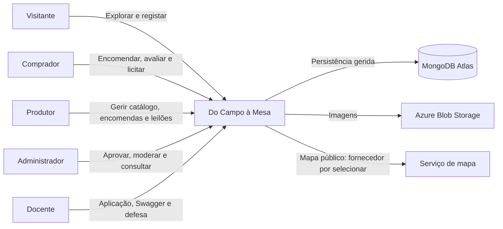
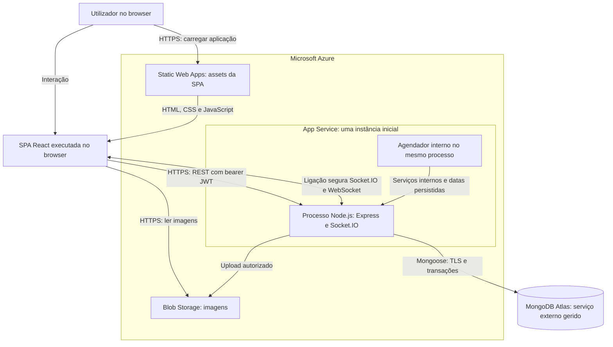
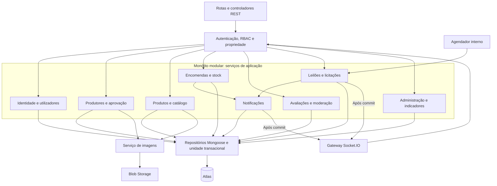
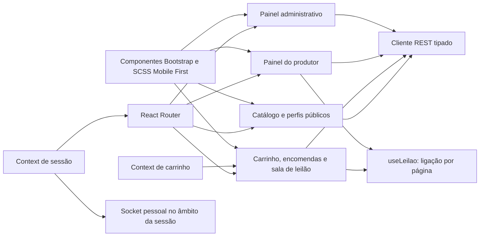

# Diagramas de arquitetura

Modelo de monólito modular escolhido em F0; referência E p. 6. Fontes e classificação em [requisitos](../requirements/functional-requirements.md). Diagramas representam a proposta, não recursos já configurados. `notifications` persistente e agendador são decisões propostas; Laravel e elasticidade ficam fora da base obrigatória.

## Contexto do sistema

Mapa é requisito funcional; fornecedor externo é uma alternativa por validar Q11. Papéis não representam serviços separados.

## Contentores lógicos e alojamento

O browser estabelece sockets diretamente com App Service. O agendador não tem publicação independente. MongoDB e Blob não são acessíveis para escrita com segredos enviados ao frontend.

## Componentes principais do backend

Dependências representam chamadas internas e acesso coordenado; não mensageria entre microsserviços. `NOT` é proposta para notificações persistentes. Broadcasts de licitações continuam sob responsabilidade de `AUC`, após commit, sem exigir uma coleção de notificações por participante.

## Componentes da SPA

Guardas de routing melhoram navegação; a API volta a autorizar todas as operações. Não existe confiança no papel declarado pelo browser.
