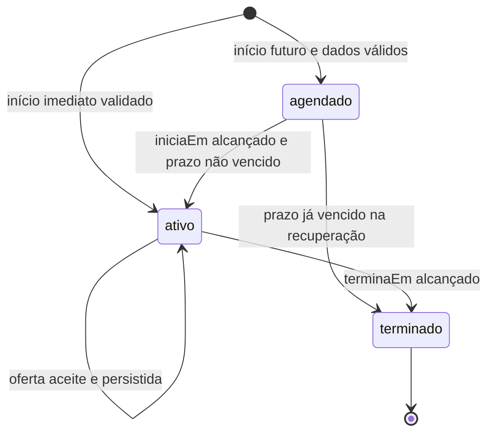
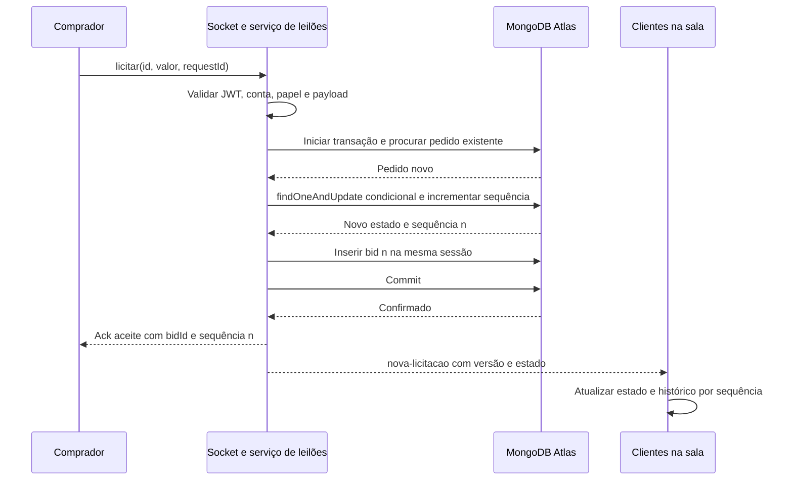
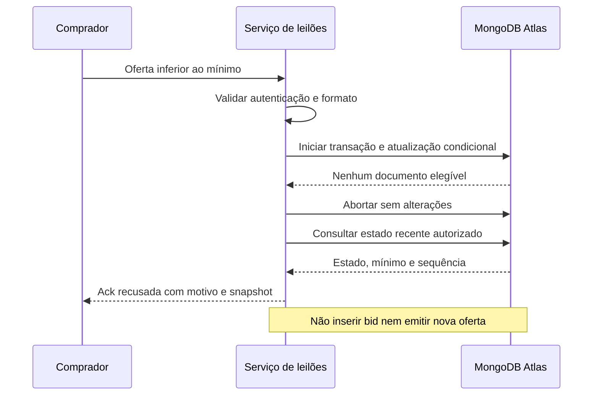
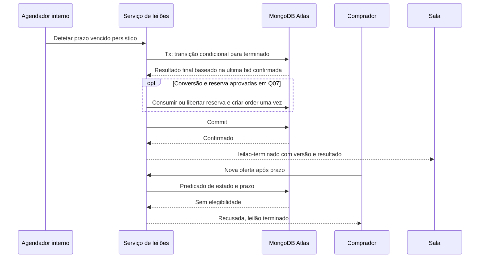

# Consistência dos leilões

## Requisito e solução proposta

E p. 7 exige que duas ofertas iguais quase simultâneas não sejam ambas aceites; E p. 21 exige validação por `findOneAndUpdate`, salas por leilão, presença, estado inicial e `terminaEm`. E p. 10 exige histórico atualizado e contagem sincronizada. Fontes/IDs: RF-LEI-01–07 e RNF-CON-01 em [requisitos](../requirements/functional-requirements.md).

A operação atómica do exemplo E p. 21 protege o valor atual. A inserção posterior em `bids` pode falhar, deixando valor e histórico divergentes. **D06 propõe uma transação curta que inclui a operação atómica e a inserção do bid.** É uma decisão de engenharia para garantir RNF-CON-03, não uma tecnologia transacional explicitamente imposta por E. Nenhum código de licitação é implementado nesta fase.

MongoDB distingue atomicidade por documento de atomicidade de alterações em vários documentos. Essa distinção fundamenta a solução. [Atomicidade MongoDB](https://www.mongodb.com/docs/manual/core/write-operations-atomicity/).

## Ciclo de vida e estados



Os três estados estão em E p. 18. Os mecanismos de ativação, encerramento e recuperação são D11. Não introduzir cancelado, rascunho, pausa ou extensão automática sem validar Q08/Q12.

Ao criar, `licitacaoAtual.valorCent = precoBaseCent`, `comprador = null`, `bidId = null`, `sequencia = 0`. E p. 21 determina início no preço base. O mínimo da **primeira** oferta é base + incremento; não criar bid artificial do preço base. Incremento tem de ser positivo. Atalhos +5/+10/+25 € são conveniência da interface e nunca substituem o mínimo do servidor (E p. 10).

## Invariantes

1. Cada oferta aceite tem um `bids` imutável e uma sequência exclusiva.
2. Após commit, se `sequencia = n > 0`, a oferta atual aponta ao bid n, com o mesmo comprador e valor; existem n bids aceites, numerados de 1 a n.
3. Sem bids, o valor mostrado é preço base e não existe vencedor.
4. Cada oferta aceite satisfaz estado ativo, prazo elegível e valor ≥ atual + incremento na operação condicional; dinheiro usa inteiros propostos D05.
5. Recusa não altera auction nem insere bid aceite. Falha na inserção faz rollback da atualização.
6. Mesmo `requestId`/comprador/leilão e payload tem um único resultado persistido; payload diferente não reutiliza a chave.
7. Ack de aceitação e broadcast só surgem depois de commit confirmado; emissão não faz parte da transação.
8. Encerramento é idempotente e não muda o vencedor depois de terminado. Conversão em encomenda/libertação de reserva depende Q07.

Datas, sequência e resultado são decididos no servidor/base de dados; o browser não arbitra concorrência.

## Validação e protocolo do comando

Proposta de pedido: leilão, valor em cêntimos, identificador estável do pedido. A identidade vem do JWT, não de `comprador` no payload. Antes da transação, validar formato, limites e conta/papel atual, incluindo expiração do token. Impedir envio de ofertas criadas enquanto desligado e não apresentar aceite apenas por envio local. Produtor observador/administrador não ganha direito de licitar por entrar na sala. Auto-licitação depende Q01.

Na unidade transacional proposta:

1. Procurar bid pela chave idempotente; se existir, validar hash e devolver o resultado desse pedido, mesmo que o leilão entretanto tenha terminado. A resposta inclui também estado atual, que pode ser posterior à oferta originalmente aceite.
2. Executar `findOneAndUpdate` condicionado ao ID, estado ativo, início alcançado, fim ainda não alcançado e mínimo. Atualizar valor/comprador/bidId, incrementar `sequencia` e `versao` e obter o novo documento. Não usar upsert.
3. Inserir bid com a sequência obtida e mesma sessão; indexes únicos asseguram sequência e pedido exclusivos. Guardar IDs/timestamp do resultado estável.
4. Confirmar commit; só depois enviar ack e broadcast. Uma repetição que recupera bid existente não cria novo broadcast de negócio.

Pode usar-se versão esperada como controlo adicional, mas um conflito de versão não deve rejeitar definitivamente uma oferta ainda válida sem reavaliação. Nunca executar «ler valor; comparar em memória; gravar sem condição». Schema valida tipos e mínimos simples; a comparação com o valor concorrente fica no predicado atómico.

**Prazo proposto Q08:** a elegibilidade temporal é avaliada pela base de dados na operação condicional, com relógio do servidor MongoDB, por exemplo comparação com `$$NOW`. A operação usa a data de fim persistida, não uma data calculada pelo browser. Um pedido recebido antes do fim mas avaliado depois é recusado; um commit de operação elegível pode acabar depois do fim. Esta semântica precisa aprovação Q08: não prometer que o instante do commit seja o instante de elegibilidade. Se o contrato escolher outra semântica, rever protocolo e testes.

## Transações, conflito e falhas

Recomendação: leitura consistente da transação, `readPreference: primary` e confirmação de escrita por maioria; sessão passada a todas as operações. Operações sequenciais, sem `Promise.all` na transação. O callback pode ser repetido pelo driver; não colocar broadcasts, emails, uploads ou outros efeitos externos dentro dele. Configurar prazo global/retries limitados e tratar conflito transitório separadamente de uma recusa comercial. [Transações no driver Node.js](https://www.mongodb.com/docs/drivers/node/current/crud/transactions/).

Se duas transações alterarem o mesmo auction, uma pode sofrer conflito; repetir a transação com leitura/predicado atualizado. Uma oferta igual deixa então de satisfazer o incremento e é recusada. Um resultado de commit desconhecido exige resolver commit/idempotência; um timeout não prova rollback. Não criar nova chave, nova bid ou comunicar recusa definitiva enquanto o resultado continuar incerto.

Se um retry idempotente encontrar conflito de índice por outro pedido igual em execução, resolver a transação concorrente e consultar o resultado persistido; não duplicar. Se indisponibilidade impedir determinar o resultado, devolver estado «a confirmar/temporariamente indisponível», orientando consulta com a mesma chave.

Ensaiar transações na configuração Atlas gratuita e versões escolhidas antes de fechar M2/M3; em integração local usar replica set, não standalone sem transações. Não estabelecer ligação nem provisionar nesta fase.

## Duas ofertas simultâneas

Exemplo de E p. 7: duas ofertas de 317 €, ambas inicialmente válidas. A ordem de chegada ao browser/socket não estabelece justiça global. A atualização confirmada primeiro vence a concorrência; a segunda reavalia e falha no mínimo. Há uma aceitação e um bid.

Para **valores diferentes**, ambas podem ser aceites sequencialmente se a segunda continuar a cumprir o incremento. Não interpretar «apenas uma licitação válida» como «apenas uma oferta aceite por janela de tempo» para qualquer par de valores. A exigência do exemplo é impedir dupla aceitação do mesmo valor e manter uma ordem comum.

## Histórico e sincronização dos clientes

Histórico numa coleção separada, ordenado por sequência; índice único leilão/seq e chave idempotente (ver [data-model.md](../database/data-model.md)). Versão do auction incrementa também em transições; sequência incrementa só em bids.

Ao entrar/reentrar: autorizar e juntar à room; obter snapshot persistido e histórico limitado à sequência desse snapshot, com leitura consistente; durante esse processo recolher eventos; aplicar eventos mais recentes de forma ordenada. Não substituir um estado mais recente por snapshot atrasado. Um gap de sequência ou versão desencadeia nova consulta. Os endpoints REST de estado/histórico permitem recuperar sem depender de replay de sockets.

Após commit, duas tarefas de emissão podem concluir fora de ordem. Cada evento traz ID/seq/versão; cliente ignora eventos antigos/repetidos, incorpora bids por ID e consulta histórico se faltar sequência. Recusa deve trazer estado recente e código de motivo seguro. Payload da oferta não expõe email ou outros dados privados.

Não existe transação entre MongoDB e broadcast Socket.IO. Uma falha do processo após commit e antes da emissão preserva a oferta, mas pode perder o evento. A base proposta recupera via consultas na reentrada e ressincronização periódica enquanto o cliente está ligado, além de gaps/acks. Se for exigida entrega durável de todos os eventos, avaliar outbox persistente e reemissão deduplicada como P posterior; não a dar por implementada. Socket.IO fornece entrega «no máximo uma vez» por omissão; recuperação de ligação pode falhar. [Garantias de entrega](https://socket.io/docs/v4/delivery-guarantees/), [recuperação](https://socket.io/docs/v4/connection-state-recovery/).

## Rooms e presença

- `leilao:<id>` isola broadcasts; ID da sala é composto no servidor depois da autorização.
- `user:<id>` deriva do JWT, para notificações pessoais; ninguém escolhe sala de outro utilizador.
- `admin:leiloes` é projeção global autorizada; não transmite dados privados de compradores.
- Presença proposta Q09 conta identidades autenticadas únicas e mantém contagem de sockets por utilizador/sala. Entrada, saída explícita e `disconnecting` atualizam corretamente; vários separadores contam uma identidade se essa recomendação for aceite. O exemplo E p. 21 conta sockets; a escolha final precisa registo.
- Room membership não substitui autorização do comando. Desligar socket de leilão no cleanup do hook (E p. 22); ligação pessoal de sessão é independente.

Uma instância inicial permite presença em memória. Várias instâncias exigem adapter para rooms/broadcast e presença global; com long-polling, considerar afinidade de sessão. Não basta duplicar o processo nem supor que a atomicidade de MongoDB distribui eventos. [Múltiplos nós Socket.IO](https://socket.io/docs/v4/using-multiple-nodes/).

## Contagem decrescente

Servidor envia `terminaEm` e `serverNow`, como extensão proposta ao requisito E p. 21. Cliente estima diferença entre relógios e atraso com amostras de ida/volta, e calcula tempo restante usando progressão monotónica entre sincronizações. Revalidar ao entrar, reconectar e voltar de separador suspenso; apresentar zero quando ultrapassar fim e desativar envio. Servidor mantém validação independente. Contagem é uma estimativa visual, não garantia de precisão absoluta da rede. Objetivo de desvio/latência a medir, não imposto por E.

## Expiração e recuperação

Agendador D11 pesquisa datas persistidas ao arranque e periodicamente. Leilão agendado cujo início passou mas fim não passou torna ativo; leilão já vencido termina diretamente, sem abertura fictícia. Em qualquer oferta, o predicado temporal rejeita leilão vencido mesmo antes da varredura.

Encerramento altera estado apenas se ainda elegível; lê o resultado mais recente no mesmo contexto de escrita e incrementa versão. Se concorrer com bid, ambos escrevem o mesmo auction: conflito provoca reavaliação e nenhum encerramento grava vencedor desatualizado. Leilão sem bids tem resultado sem licitações e comprador nulo. Se Q07 aprovar reserva/conversão, incluir mudança de reserva e criação idempotente de order na transação de encerramento. Não adjudicar o preço base a alguém nem converter stock duas vezes.

Em reinício ou em dois encerradores, condições e idempotência evitam repetição; timer local não é fonte da verdade. Depois de commit transmitir estado final. Se a emissão falhar, consultas recuperam o término. TTL não encerra leilão e não deve apagar bids.

## Erros e resposta

| Situação | Resposta proposta | Efeito persistido |
| --- | --- | --- |
| Token ausente/expirado; papel insuficiente | Recusa de ligação/comando, reautenticação; equivalente 401/403 no REST. | Nenhum bid. |
| Payload ou valor inválido | Código `DADOS_INVALIDOS`, mensagem pt-PT. | Nenhum bid. |
| Oferta abaixo do mínimo / leilão inativo ou vencido | Recusa correlacionada e snapshot recente. | Nenhuma alteração. |
| Conflito de escrita transitório | Retry da transação dentro do prazo definido; reavaliar regras. | Um único commit ou recusa. |
| Falha ao inserir bid | Abortar transação; erro técnico recuperável. | Nem novo valor nem bid. |
| Commit com resultado desconhecido | Resolver commit/chave; comunicar incerteza se necessário. | Não assumir aceitação nem rollback sem confirmação. |
| Mesmo pedido reenviado | Devolver bid existente e estado atual. | Sem nova oferta. |
| Broadcast perdido | Snapshot/histórico e versão corrigem apresentação. | Bid/auction permanecem confirmados. |

Socket acknowledgements e erros de domínio são documentados no protocolo; códigos HTTP aplicam-se apenas às operações REST. Mensagens de erro são verificáveis, sem detalhes internos do banco.

## Diagramas de sequência

### 1. Oferta aceite



### 2. Oferta recusada



### 3. Duas ofertas iguais concorrentes

```mermaid
sequenceDiagram
    participant A as Comprador A
    participant B as Comprador B
    participant S as Serviço de leilões
    participant DB as MongoDB Atlas
    participant R as Sala
    par Oferta A
        A->>S: 317 EUR, pedido A
    and Oferta B
        B->>S: 317 EUR, pedido B
    end
    S->>DB: Tx A: CAS válido e bid n
    S->>DB: Tx B: escrita concorrente no mesmo auction
    DB-->>S: B encontra conflito transitório
    S->>DB: Commit A
    DB-->>S: A confirmado com valor 317 EUR
    S-->>A: Aceite
    S-->>R: Estado confirmado, sequência n
    S->>DB: Retry Tx B e reavaliar mínimo
    DB-->>S: 317 EUR abaixo de atual mais incremento
    S->>DB: Abortar B sem bid
    S-->>B: Recusada e estado recente
    Note over A,B: A é vencedor ilustrativo; a ordem não é garantida
```

### 4. Expiração



## Evidência de teste prevista

Dois clientes com valor igual; valores diferentes e reavaliação; inserção de bid a falhar; retry com mesma chave; payload diferente; commit/ack perdido; broadcast fora de ordem; oferta no limite; ativação/término após restart; dois encerradores; token a expirar numa ligação longa; reconexão sem replay; presença multi-separador; recuperação da sala com snapshot concorrente. Ver [plano](../planning/implementation-plan.md). Não executar estes testes nem criar lógica nesta fase documental.
