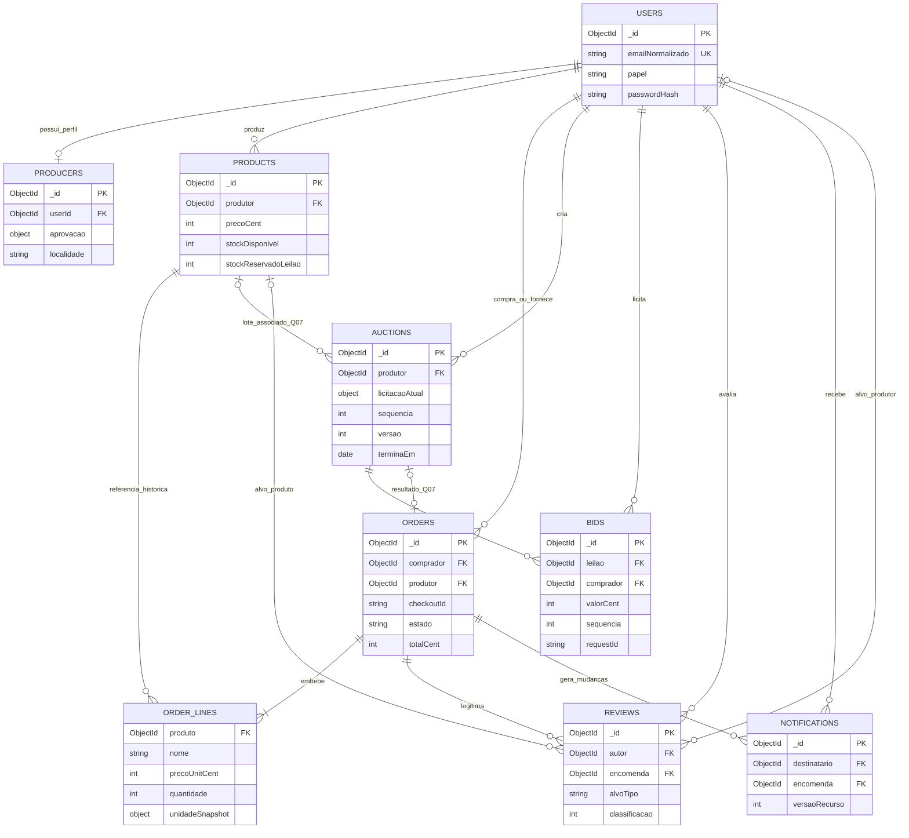

# Modelo de dados MongoDB

## Base, notação e limites

E p. 18 exige `users`, `products`, `orders`, `auctions` e `bids`, linhas de encomenda embebidas, referências de comprador/produtor e validação `required`/`enum`/`min`. As coleções `producers`, `reviews` e `notifications` são avaliadas abaixo. Fontes: [requisitos](../requirements/functional-requirements.md); decisões D03–D09 em [decisions.md](../architecture/decisions.md).

Este é um **desenho proposto**, não schemas implementados. «Obrigatório» nas tabelas significa campo exigido pelo schema proposto, não obrigação textual adicional de E. Q01–Q16 condicionam enums, cardinalidades e regras finais. Campos técnicos em português, coleções em inglês; todas incluem `_id: ObjectId`, `createdAt: Date` e `updatedAt: Date` obrigatórios, geridos no servidor. Datas persistidas em UTC; apresentação em Europe/Lisbon. Referências MongoDB não garantem integridade relacional por si: validar existência, elegibilidade e permissões no serviço.

Dinheiro `*Cent`: inteiro não negativo, finito e dentro de limites seguros de aritmética JavaScript/BSON; proposta D05 para EUR, pendente Q06. Quantidades: inteiros de unidades comerciais, pendente Q03; não usar floats para pesos variáveis sem rever a representação. Strings normalizadas e com comprimentos máximos a fixar no contrato. Arrays embebidos limitados; coleções com crescimento potencialmente ilimitado referenciadas. Índices propostos são verificados com consultas reais, não criados indiscriminadamente.

## `users` — contas, papéis e identidade

| Campo | Tipo | Obrigatório | Validação e significado |
| --- | --- | --- | --- |
| `nome` | String | Sim | Nome público/da conta não vazio; exposição reduzida conforme Q10. |
| `emailNormalizado` | String | Sim | Formato válido; trim/case normalizados; unicidade pelo índice, não apenas validator. |
| `passwordHash` | String | Sim | Hash bcrypt; excluído das projeções públicas. Password em claro não é campo. |
| `papel` | String enum | Sim | `comprador`, `produtor`, `administrador`; papel único proposto Q01; não inclui visitante. |
| `ativo` | Boolean | Sim | Controlo técnico de acesso proposto; default verdadeiro; suspensão e poderes a definir, não requisito novo. |
| `versaoPermissoes` | Integer | Sim | ≥ 0; usado para invalidar permissões antigas se adotado; não substitui verificação da conta. |

**Referências:** compradores/produtores em orders e auctions apontam para users, preservando o exemplo E p. 18. Perfil específico em producers, ligado por `userId`. **Índices:** único `{emailNormalizado: 1}`; `{papel: 1, createdAt: -1}` se usado no painel. **Relacionamentos:** user pode ter um perfil produtor; tem várias encomendas, bids, reviews e notificações. Moradas de encomenda não são expostas em users públicos. Criar administrador por procedimento controlado, D03; registo aceita apenas comprador/produtor.

## `producers` — perfil e aprovação, coleção adicional recomendada

| Campo | Tipo | Obrigatório | Validação e referência |
| --- | --- | --- | --- |
| `userId` | ObjectId → users | Sim | User com papel/capacidade produtor; imutável. |
| `nomePublico` | String | Sim | Nome comercial/público não vazio. |
| `descricao` | String | Não | Texto limitado, sem HTML ativo não sanitizado. |
| `localidade` | String | Sim | Normalizada para filtro; taxonomia Q14. |
| `localizacao` | Objeto embebido | Não; obrigatório para publicar mapa conforme Q11 | `latitude` Number entre −90 e 90; `longitude` entre −180 e 180; localização autorizada para divulgação. |
| `imagens` | Array de metadados embebidos | Não | Mesmo formato de products; número limitado. |
| `aprovacao.estado` | String enum embebido | Sim | `pendente`, `aprovado`, `rejeitado`; default pendente. |
| `aprovacao.decididoPor` | ObjectId → users | Condicional | Administrador quando aprovado/rejeitado; ausente enquanto pendente. |
| `aprovacao.decididoEm` | Date | Condicional | Obrigatório para decisão final. |
| `aprovacao.motivo` | String | Não | Justificação; visibilidade restrita e política Q04. |
| `moderacao` | Objeto embebido | Não | Visibilidade, autor/data/motivo propostos para ocultação, Q12. |

**Índices:** único `{userId: 1}`; `{ 'aprovacao.estado': 1, createdAt: 1 }`; `{localidade: 1, userId: 1}` para perfis elegíveis. Sem índice geoespacial obrigatório: mapa não exige pesquisa por raio. **Relações:** um user → no máximo um perfil; produto/leilão continuam a referenciar user produtor, cuja elegibilidade é resolvida pelo perfil. Aprovação não está embutida no JWT como única fonte de verdade.

**Avaliação:** separar facilita moderação e consulta de candidaturas, evita muitos campos vazios em compradores. Embutir perfil em users seria válido num modelo simples, mas misturaria acesso privado e público. Decisão proposta D09, não coleção obrigatória de E.

## `products` — catálogo e stock

| Campo | Tipo | Obrigatório | Validação e referência |
| --- | --- | --- | --- |
| `produtor` | ObjectId → users | Sim | Produtor proprietário; atribuído pela sessão, não pelo corpo do pedido. |
| `nome` / `descricao` | String | Sim / Não | Nome não vazio; descrição limitada. |
| `categoria` | String enum | Sim | Valores controlados a validar Q14. |
| `ingredientes` | Array de String | Não | Termos normalizados; pesquisa por ingrediente prevista; limites Q14. |
| `epocaMeses` | Array de Integer | Não | Meses 1–12 sem duplicados; semântica a validar Q14. |
| `modoProducao` | String enum | Sim | Inclui valor biológico; taxonomia pendente Q14. |
| `precoCent` | Integer | Sim | ≥ 0; possibilidade de preço zero precisa confirmação Q06; serviço define limites. |
| `moeda` | String | Sim | Proposta `EUR`, Q06. |
| `unidadeVenda` | Objeto embebido | Sim | `codigo`, `rotulo` e, quando relevante, tamanho da embalagem; unidades Q03. |
| `stockDisponivel` | Integer | Sim | ≥ 0; unidades comercializáveis ainda livres. |
| `stockReservadoLeilao` | Integer | Sim na proposta de Q07 | ≥ 0; stock separado do disponível; não reservado por carrinho. |
| `limiarStockBaixo` | Integer | Não | ≥ 0; política Q15. |
| `imagens` | Array de objeto embebido | Não | `blobKey`, `url`, `mimeType`, `sizeBytes`, `alt`; dimensões opcionais; máximo a acordar; sem credenciais/SAS de escrita. |
| `visibilidade` | String enum | Sim | `publicado`, `oculto`, `arquivado`; proposta Q04/Q12; não publicar sem produtor elegível. |
| `versao` | Integer | Sim | ≥ 0; incremento nas alterações para controlo de concorrência. |

**Índices:** `{produtor: 1, visibilidade: 1}`; `{visibilidade: 1, categoria: 1, precoCent: 1}`; `{modoProducao: 1, visibilidade: 1}` se seletivo; índices multikey **separados** de `ingredientes` e `epocaMeses` se necessários. Não criar composto com dois arrays paralelos. Pesquisa regex não ancorada não tem eficiência garantida por índice de nome; limitar entrada e paginar. Filtro por localidade resolve producers elegíveis → IDs de users → products, evitando duplicação de localidade desatualizada.

**Relações:** produto tem um proprietário, muitas linhas de encomenda e zero ou vários leilões ao longo do tempo. Fotografias são metadados embebidos, bytes em Blob. Arquivar protege referências históricas; E exige DELETE, cujo contrato pode retirar catálogo com 204 sem apagamento físico (Q12).

## `orders` — encomendas e snapshots

| Campo | Tipo | Obrigatório | Validação e referência |
| --- | --- | --- | --- |
| `comprador` | ObjectId → users | Sim | Comprador da sessão; imutável. |
| `produtor` | ObjectId → users | Sim | Proprietário dos produtos da encomenda; apenas um produtor no modelo proposto Q02. |
| `checkoutId` | String | Sim | Chave idempotente do comprador; partilhada pelas encomendas do mesmo checkout. |
| `requestHash` | String | Sim | Resumo canónico do payload inicial para rejeitar reutilização indevida da chave. |
| `linhas` | Array de subdocumento | Sim | Não vazio; limite definido; todos os produtos têm o mesmo produtor. |
| `linhas[].produto` | ObjectId → products | Sim | Referência histórica; conteúdo comercial provém do snapshot. |
| `linhas[].nome` | String | Sim | Nome no momento da compra; imutável. |
| `linhas[].precoUnitCent` | Integer | Sim | Preço da unidade comercial no checkout, calculado pelo servidor. |
| `linhas[].quantidade` | Integer | Sim | ≥ 1, Q03. |
| `linhas[].unidadeSnapshot` | Objeto embebido | Sim | Código/rótulo/tamanho da unidade no momento da compra. |
| `linhas[].subtotalCent` | Integer | Sim | Igual a preço unitário × quantidade, com verificação de overflow. |
| `subtotalCent` / `totalCent` | Integer | Sim | Soma de linhas / soma e encargos acordados Q06; cliente não define os totais. |
| `moeda` | String | Sim | Mesma moeda das linhas; proposta EUR. |
| `estado` | String enum | Sim | `pendente`, `confirmada`, `pronta`, `entregue`; default pendente; transições Q05. |
| `entrega` | Objeto embebido | Sim | `tipo`: levantamento/entrega; `moradaSnapshot` obrigatória para entrega; instruções/local de levantamento conforme Q06. |
| `historicoEstado` | Array de subdocumento | Sim | Estado/data/autor; limitado pelo ciclo de vida acordado; registado junto com transição. |
| `versao` | Integer | Sim | Incrementa em cada mudança; base para evento e CAS. |
| `origemLeilao` | ObjectId → auctions | Não | Só se conversão Q07 for aprovada; único quando presente. |

**Índices:** `{comprador: 1, createdAt: -1}`, `{produtor: 1, estado: 1, createdAt: -1}`; único `{comprador: 1, checkoutId: 1, produtor: 1}`; único parcial `{origemLeilao: 1}` apenas para ObjectId, se Q07 for aprovado. Consultar encomendas do checkout com comprador/chave, verificar hash e devolver o grupo inteiro. Não gerar uma chave nova por retry após timeout.

**Embedding:** linhas, entrega e histórico limitado são lidos com a encomenda e preservam identidade comercial, mesmo se produto/preço/morada mudarem. Users/produtos partilhados são referências. É requisito E p. 18 embeber linhas e referenciar comprador/produtor; demais campos são concretização D05/D08.

**Conversão de lote:** a oferta é preço total do lote, não preço por kg. Se Q07 for aprovado, usar uma linha comercial «lote» com quantidade 1 e preço unitário igual à oferta, guardando também snapshot da composição/quantidade física para a reserva. Rever schema e contrato antes de implementar; não dividir silenciosamente o valor da oferta pelo número de unidades nem debitar stock duas vezes.

## `auctions` — estado atual e ciclo de vida

| Campo | Tipo | Obrigatório | Validação e referência |
| --- | --- | --- | --- |
| `produtor` | ObjectId → users | Sim | Proprietário autenticado e elegível conforme Q04. |
| `produto` | ObjectId → products | Condicional | Se lote de catálogo for opção aceite Q07; produto do mesmo produtor. |
| `lote` | Objeto embebido | Sim | Nome/descrição e quantidade/unidade do lote; conteúdo e reserva Q07. |
| `precoBaseCent` | Integer | Sim | ≥ 0, regra de zero Q06. |
| `incrementoCent` | Integer | Sim | > 0; primeiro mínimo = base + incremento, E p. 21. |
| `licitacaoAtual.valorCent` | Integer embebido | Sim | Inicializa no preço base; maior oferta aceite após primeira bid. |
| `licitacaoAtual.comprador` | ObjectId → users | Não inicialmente | Null sem bids; obrigatório após oferta aceite. |
| `licitacaoAtual.bidId` | ObjectId → bids | Não inicialmente | Null sem bids; aponta para bid da sequência atual. |
| `iniciaEm` / `terminaEm` | Date | Sim | Fim posterior ao início; duração limitada a acordar; Q08. |
| `estado` | String enum | Sim | `agendado`, `ativo`, `terminado`, conforme E p. 18. Sem estado cancelado implícito. |
| `sequencia` | Integer | Sim | Inicial 0; aumenta uma vez por bid aceite; é também contador do histórico. |
| `versao` | Integer | Sim | Incrementa em ofertas e transições de estado; distingue estado de sequência de bids. |
| `resultado` | Objeto embebido | Condicional | Após término: `sem_licitacoes` ou `adjudicado`, vencedor/valor/bid; a adjudicação comercial/conversão depende Q07. |
| `encerradoEm` | Date | Condicional | Após encerramento; pode ser posterior à data de fim se houve reinício. |
| `reserva` | Objeto embebido | Não; conforme Q07 | Quantidade, estado reservado/consumido/libertado; controla uma única conversão/libertação. |

**Índices:** `{estado: 1, terminaEm: 1}`, `{estado: 1, iniciaEm: 1}`, `{produtor: 1, createdAt: -1}`. Não TTL: expiração deve encerrar e preservar histórico, não eliminar documento. Busca de bids pelo índice da própria coleção. **Relações:** um produtor, lote opcionalmente ligado a produto, muitos bids e no máximo uma encomenda resultante se Q07 aprovado.

**Embedding:** resumo da oferta atual e lote são pequenos e lidos juntos. Histórico não é array no leilão; é obrigatório manter coleção bids e permite crescimento/paginação. O preço base não é bid nem prova de vencedor.

## `bids` — histórico imutável de ofertas aceites

| Campo | Tipo | Obrigatório | Validação e referência |
| --- | --- | --- | --- |
| `leilao` | ObjectId → auctions | Sim | Leilão existente e elegível no instante da operação. |
| `comprador` | ObjectId → users | Sim | Identidade do comando; papel elegível. |
| `valorCent` | Integer | Sim | ≥ valor anterior + incremento; validação no serviço/predicado atómico, não só schema. |
| `sequencia` | Integer | Sim | ≥ 1; atribuída atomicamente pelo leilão. |
| `requestId` | String | Sim | Chave idempotente estável do comando; comprimento limitado. |
| `requestHash` | String | Sim | Compara mesmo pedido após retry; diferente payload não reutiliza chave. |
| `aceiteEm` | Date | Sim | Timestamp do servidor/base de dados; ordenação autoritativa é sequência. |

**Índices:** único `{leilao: 1, sequencia: 1}`; único `{leilao: 1, comprador: 1, requestId: 1}`; `{comprador: 1, createdAt: -1}` apenas se houver consulta justificada. Histórico paginado por sequência. **Regras:** não editar/apagar bids aceites na gestão normal; recusas não são bids, podendo ser registadas em logs sem dados excessivos. Cada atualização de oferta tem bid correspondente no mesmo commit. Não embutir lista ilimitada nem usar TTL.

## `reviews` — avaliações, coleção adicional recomendada

| Campo | Tipo | Obrigatório | Validação e referência |
| --- | --- | --- | --- |
| `autor` | ObjectId → users | Sim | Comprador elegível. |
| `encomenda` | ObjectId → orders | Sim | Entregue e do autor; Q10. |
| `alvoTipo` | String enum | Sim | `produto` ou `produtor`. |
| `produto` | ObjectId → products | Condicional | Presente só para alvo produto, que pertence às linhas da encomenda. |
| `produtor` | ObjectId → users | Condicional | Presente só para alvo produtor, igual ao da encomenda. |
| `classificacao` | Integer | Sim | Proposta 1–5, pendente Q10. |
| `comentario` | String | Não | Comprimento limitado e apresentação segura. |
| `moderacao` | Objeto embebido | Sim | Visível/oculta, decisão de administrador, motivo/data; política Q10/Q12. |
| `denuncias` | Array de subdocumento | Não | Autor/data/motivo; proposta limitada e com uma denúncia por autor. Se crescimento livre necessário, extrair coleção futura. |

**Índices:** únicos parciais `{autor: 1, encomenda: 1, produto: 1}` para alvo produto e `{autor: 1, encomenda: 1, produtor: 1}` para alvo produtor, condicionados a Q10; `{produto: 1, 'moderacao.estado': 1, createdAt: -1}` e equivalente de produtor. **Regras:** exatamente uma referência de alvo conforme tipo; não aceitar alvo inexistente/alheio; recalcular agregados públicos sem avaliações ocultas. Índice único não substitui elegibilidade. Denúncia/moderação não permite modificar classificação em nome do comprador.

**Avaliação:** avaliações são obrigatórias E p. 4/10; coleção separada facilita paginação e moderação. Embuti-las em products/users provocaria crescimento e mistura de permissões. Denúncias pequenas e limitadas podem ser embebidas; limite concreto decidido no contrato.

## `notifications` — melhoria de persistência recomendada

| Campo | Tipo | Obrigatório | Validação e referência |
| --- | --- | --- | --- |
| `destinatario` | ObjectId → users | Sim | Comprador/produtor envolvido; servidor atribui. |
| `tipo` | String enum | Sim | Base proposta `encomenda_atualizada`; outros apenas após desenho. |
| `encomenda` | ObjectId → orders | Sim na base | Recurso autorizado ao destinatário. |
| `versaoRecurso` | Integer | Sim | Versão da mudança persistida. |
| `payload` | Objeto embebido | Sim | ID/estado/data mínimos; não duplicar morada nem dados privados. |
| `lidaEm` | Date | Não | Null até leitura, alteração apenas pelo destinatário. |
| `emitidaEm` | Date | Não | Tentativa de transmissão; não prova de receção. |

**Índices:** `{destinatario: 1, createdAt: -1}`, `{destinatario: 1, lidaEm: 1}` se usado; único `{destinatario: 1, encomenda: 1, versaoRecurso: 1, tipo: 1}`. Sem TTL até definir retenção; não tratar TTL como mecanismo de notificações ou leilões.

**Avaliação:** E exige notificações em tempo real, não caixa de notificações persistente. D09/RF-MEL-03 propõem guardar junto com a transição e permitir recuperação. Emissão pode repetir após falha; consumidor deduplica por ID/versão. Não garante receção exatamente uma vez. Se não adotada, persistência de orders e consulta REST continuam obrigatórias para recuperar o estado.

## Consistência e transações

1. **Checkout proposto:** procurar resultado pela chave; validar payload e preços atuais; por produto, decrementar condicionalmente `stockDisponivel >= quantidade`; criar snapshots e orders do grupo numa transação; abortar integralmente se uma linha falhar. Repetição retorna resultado persistido, nunca debita outra vez. Carrinho não reserva stock.
2. **Leilão:** CAS sobre estado/prazo/mínimo e incremento de sequência + bid na mesma sessão/transação; referência da oferta atual usa o bid criado. Falha num passo aborta ambos. [Protocolo detalhado](../architecture/auction-consistency.md).
3. **Reservas Q07:** publicar lote move quantidade disponível para reservada numa transação; consumi-la no resultado não volta a debitar disponível. Sem ofertas liberta uma vez. API de ajuste de stock não pode ignorar reservas. Implementar só após Q07.
4. **Encomenda e notificações P:** CAS de estado/versão grava histórico e notificações de comprador/produtor na mesma transação; transmitir depois do commit. Nova tentativa respeita idempotência/versão.
5. **Integridade de leitura:** obter snapshot de leilão e bids associados com leitura consistente ou limite de sequência do snapshot; não mostrar uma oferta ainda não confirmada. Reviews dependem de encomenda entregue.

MongoDB garante atomicidade ao nível do documento; envolver vários documentos sem transação não garante a atomicidade do checkout ou do par auction/bid. A transação é a solução proposta para estes invariantes. [Atomicidade e transações MongoDB](https://www.mongodb.com/docs/manual/core/write-operations-atomicity/). Validar compatibilidade do deployment e versões na fase seguinte; testes de integração exigem replica set local/Atlas, não MongoDB standalone sem suporte transacional.

## Consultas a demonstrar

E p. 18 exige pelo menos uma consulta com um dos operadores indicados. Proposta didática: `$regex` com texto escapado/limitado em nome/ingredientes; `$gte` e `$lte` em intervalo de preço; `$lt` em leilões que terminam antes de limite futuro, incluindo condição ativa. Estes exemplos são especificações de consulta, não implementação nesta fase. Paginação e limites de resultados são P de desempenho.

## Diagrama entidade–relação

O diagrama mostra relações lógicas, sem sugerir foreign keys automáticas. Um user pode desempenhar diferentes relações, conforme papel; coleção notifications e ligação order→auction são propostas condicionadas.

`ORDER_LINES` é subdocumento, não coleção. `FK` significa referência lógica. Produto/produtor em reviews são mutuamente exclusivos; o desenho condicional deve ser validado pelo schema e serviço.
