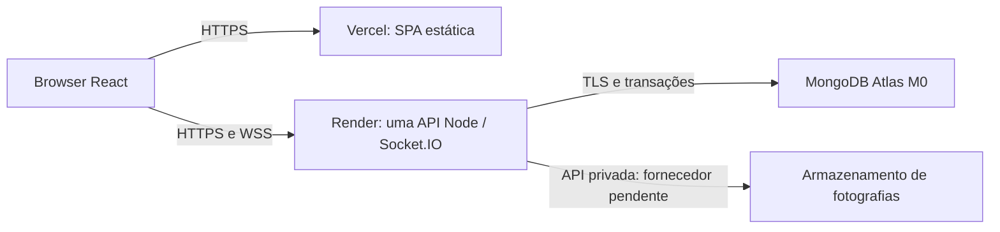

# Fase 13A — preparação da infraestrutura Cloud

## Estado e autorizações

Preparação local sobre `feat/api-foundation`, base `7dec2ea767b47ff9d2b058e0330914b4c4304746`. A Fase 12 está publicada; esta fase ainda não foi consolidada. `main` permanece em `c10d031dafc3a0173f5540875152f35f61bb1549`.

**Não existe deployment realizado nem URL pública verificada.** O utilizador indicou não ter contas nos fornecedores propostos. A escolha do armazenamento continua expressamente pendente depois da comparação entre Blob, S3 e Cloud Storage. Nenhuma conta, subscrição, faturação, recurso ou domínio foi criado nesta tarefa.

O utilizador aprovou a limpeza **manual**, precedida de simulação, de fotografias sem referências há pelo menos sete dias, com a API parada e sem outros escritores. Essa política não autoriza executar uma limpeza num ambiente externo.

Não foram autorizados staging, commits, push, alterações de branches, merges ou Pull Requests. A primeira publicação e a criação de recursos exigem aprovação própria. A autorização para preparar configurações locais não constitui autorização para aplicar os ficheiros aos fornecedores.

## Requisitos e arquitetura proposta

O enunciado académico, página 23, pede alojamento PaaS da API/SPA, MongoDB Atlas, imagens em Blob Storage, S3 ou Cloud Storage e HTTPS/WSS. A arquitetura inicial referencia Azure App Service, Static Web Apps e Blob. As propostas Vercel/Render são alternativas de alojamento PaaS a justificar; os nove documentos originais da Fase 0 permanecem intactos.



Vercel serve apenas o frontend. A API Express mantém um processo persistente e uma única instância no Render. MongoDB permanece a fonte de verdade. O browser obtém fotografias pelo gateway autorizado `/api/media/:id`; não recebe credenciais nem URLs assinados do armazenamento.

Não há alterações intencionais às regras de checkout, pagamento, stock, reservas, leilões, vencedores, avaliações ou autorização. As três áreas privadas, carrinho, navegação e design system permanecem na implementação aprovada. Não foram adicionadas dependências nem alteradas versões do lockfile.

## Fornecedores, planos e custos

Condições consultadas em **3 de novembro de 2026**; confirmar novamente no ecrã de criação antes de aprovar qualquer recurso. Preços, regiões, elegibilidade e verificações de identidade podem mudar. Não foram configurados pagamentos, upgrades automáticos ou serviços pagos.

| Componente      | Proposta                                 | Condições relevantes                                                                                                | Estado                                     |
| --------------- | ---------------------------------------- | ------------------------------------------------------------------------------------------------------------------- | ------------------------------------------ |
| Frontend        | Vercel Hobby                             | Gratuito para uso pessoal e não comercial; 100 GB de transferência rápida e 1 milhão de pedidos CDN incluídos       | Conta e primeira publicação pendentes      |
| API e Socket.IO | Render Free, Frankfurt, uma instância    | 750 horas gratuitas por workspace/mês; repouso após 15 minutos sem tráfego recebido; arranque a frio; disco efémero | Conta, disponibilidade e criação pendentes |
| Base de dados   | Atlas M0, região europeia próxima da API | 0,5 GB incluindo índices; replica set com três nós; 500 ligações; limite de 100 operações/s; sem backup automático  | Conta, região e rede pendentes             |
| Fotografias     | Blob, S3 ou Cloud Storage                | Depende de elegibilidade, duração dos créditos, tráfego, operações e região                                         | **Escolha expressamente pendente**         |

Vercel Hobby serve a demonstração académica não comercial; uma operação comercial exigiria reavaliar o plano. Não existe garantia de disponibilidade contínua nesta proposta gratuita. Ver [Hobby](https://vercel.com/docs/plans/hobby) e [uso permitido](https://vercel.com/docs/limits/fair-use-guidelines).

O Render pode suspender o serviço ou impedir builds quando se esgotam quotas sem método de pagamento. O arranque a frio pode ultrapassar o timeout de 10 segundos do frontend e apresentar o erro recuperável já existente; ensaiar essa experiência antes de aceitar o plano para a demonstração. Não se aumentaram timeouts para disfarçar o repouso. Não adicionar um cartão para contornar limites. Não usar pedidos artificiais para impedir o repouso. O disco não preserva fotografias entre reinícios. WebSockets são suportados e devem reconectar após interrupções. Ver [Free](https://render.com/docs/free) e [WebSockets](https://render.com/docs/websocket).

Atlas M0 destina-se a aprendizagem e demonstrações, suporta transações e pode pausar após 30 dias sem ligações. O tamanho dos índices conta para a quota. A ausência de backups automáticos exige um procedimento aprovado de exportação de dados fictícios antes de alterações externas relevantes. Ver [limites M0](https://www.mongodb.com/docs/atlas/reference/free-shared-limitations/) e [criação gratuita](https://www.mongodb.com/docs/atlas/tutorial/deploy-free-tier-cluster/).

### Comparação do armazenamento — decisão não tomada

| Alternativa                            | Cartão e oferta consultada                                                                                                                               | Vantagens                                                                                      | Limitações e confirmação necessária                                                                                          |
| -------------------------------------- | -------------------------------------------------------------------------------------------------------------------------------------------------------- | ---------------------------------------------------------------------------------------------- | ---------------------------------------------------------------------------------------------------------------------------- |
| Azure Blob com Azure for Students      | 100 USD por 12 meses, sem cartão, mediante elegibilidade académica                                                                                       | Corresponde literalmente ao PDF; aproxima-se da arquitetura original; possível região europeia | Confirmar elegibilidade, disponibilidade e preço por região; crédito consumível, não armazenamento gratuito ilimitado        |
| Amazon S3 com AWS Free Plan            | Até seis meses; créditos iniciais e adicionais até 200 USD; para a maioria dos novos clientes não é exigido cartão, mas pode haver verificação adicional | Corresponde ao PDF; armazenamento privado e permissões por bucket                              | Confirmar experiência de registo aplicável à conta, validade dos créditos e preços de pedidos/tráfego; não ativar plano pago |
| Google Cloud Storage                   | Trial de 300 USD por 90 dias; requer cartão/verificação e conta de faturação do trial                                                                    | Corresponde ao PDF; gestão de objetos e regiões                                                | Menos adequado à restrição atual de não configurar faturação; quotas gratuitas têm restrições regionais                      |
| Cloudinary Free, avaliado inicialmente | Sem cartão; 25 créditos partilhados entre armazenamento, tráfego e transformações                                                                        | API de imagens; adaptador candidato preparado localmente                                       | Não corresponde literalmente às três opções do PDF; localização padrão nos EUA; utilização não aprovada pelo utilizador      |

A recomendação técnica apresentada foi avaliar Azure Blob com Azure for Students se houver elegibilidade. **O utilizador optou por manter a escolha pendente**, pelo que não existe seleção implícita de Azure ou Cloudinary.

Fontes: [Azure for Students](https://azure.microsoft.com/en-us/free/students), [limite de gastos Azure](https://learn.microsoft.com/en-us/azure/cost-management-billing/manage/spending-limit), [subscrição de estudante desativada](https://learn.microsoft.com/en-us/azure/cost-management-billing/manage/azurestudents-subscription-disabled), [preços Blob por região](https://azure.microsoft.com/en-us/pricing/details/storage/blobs/), [AWS Free Tier FAQ](https://aws.amazon.com/free/free-tier-faqs/), [Google Cloud trial](https://cloud.google.com/signup-faqs), [Cloudinary Free](https://cloudinary.com/pricing), [créditos Cloudinary](https://cloudinary.com/documentation/billing_and_plans) e [região padrão Cloudinary](https://cloudinary.com/documentation/developer_onboarding_faq_storage).

Não foi possível fixar um preço numérico Blob aplicável à conta/região sem confirmar a oferta. Antes de criar o armazenamento, apresentar estimativa para GB/mês, operações e tráfego de saída, mantendo os limites da oferta sem upgrade. Alertas orçamentais não são, por si só, um teto de despesa. Se o registo solicitar faturação ou cartão não previstos, parar e consultar o utilizador.

## Proposta concreta de recursos — ainda não aplicar

| Recurso proposto                      | Plano/região                                        | Variáveis ou dados necessários                                                              | Impacto e reversão                                                                                              |
| ------------------------------------- | --------------------------------------------------- | ------------------------------------------------------------------------------------------- | --------------------------------------------------------------------------------------------------------------- |
| Projeto `docampo-web-demo`            | Vercel Hobby; distribuição CDN                      | Origem HTTPS definitiva da API, branch aprovada e raiz do monorepo                          | Torna a SPA pública; retirar deployment/projeto ou repor deployment anterior                                    |
| Web service `docampo-api-demo`        | Render Free, Frankfurt, uma instância               | URI Atlas, JWT aleatório, origem exata da SPA, armazenamento escolhido                      | Expõe API/WSS; suspender serviço ou repor build anterior; dados não são revertidos automaticamente              |
| Projeto/cluster Atlas de demonstração | M0, região europeia disponível próxima de Frankfurt | Conta, utilizador `readWrite` apenas em `docampo_demo`, intervalos de saída reais do Render | Persistência externa de dados fictícios; revogar utilizador/rede, preservar ou exportar dados antes de eliminar |
| Contentor/bucket privado              | Fornecedor e região pendentes                       | Escolha, elegibilidade, preço, namespace e credencial limitada ao armazenamento             | Persiste imagens; revogar acesso sem eliminar objetos e restaurar serviço anterior                              |

Os nomes são sugestões, não recursos existentes nem URLs reservados. Não é necessário adquirir domínio: usar inicialmente subdomínios HTTPS dos fornecedores. Não é necessário criar Postgres, Redis, disco persistente ou serviço pago no Render. A importação/criação pode desencadear o primeiro build: confirmar a branch aprovada antes de avançar, sem publicar automaticamente a `main`. Se a interface não permitir escolher essa origem antes da publicação, parar e preparar uma publicação manual do snapshot aprovado.

**A — Pode ser concluído localmente:** ficheiros de configuração, builds, testes isolados, comparação, documentação e inventário Git. **B — Exige intervenção do utilizador:** criação/login das contas, verificação académica/identidade, escolha do armazenamento, configuração privada dos segredos. **C — Exige autorização adicional:** criar recursos, aplicar configurações externas, primeira publicação, bootstrap externo e eventual consolidação Git necessária ao deployment.

Antes da primeira operação externa, confirmar individualmente serviço, recurso, plano, região, custos, variáveis, impacto e reversão. Não aplicar `render.yaml` ou importar o projeto Vercel só porque os ficheiros existem.

## Configuração e publicação da API

O plano web Free consultado disponibiliza 0,1 CPU e 512 MB de RAM; medir memória durante normalização de imagens e latência sob carga antes de aceitar a capacidade do ambiente. Não foi executado um teste de carga no Render. O [blueprint local](../../render.yaml) fixa `plan: free`, Frankfurt, uma instância, branch `feat/api-foundation` e `autoDeployTrigger: off`. O plano é explícito porque omiti-lo pode selecionar um plano pago. A raiz do serviço é a raiz do repositório.

```sh
# Comandos previstos no fornecedor, não executados nesta tarefa contra serviços Cloud.
SCARF_ANALYTICS=false npm ci --include=dev
npm run build --workspace @docampo/api
npm start --workspace @docampo/api
```

`--include=dev` mantém TypeScript disponível durante o build mesmo com `NODE_ENV=production`. O arranque usa o JavaScript compilado. O build copia os recursos locais de Swagger UI. Node 22 é proposto na plataforma; a versão patch efetiva terá de ser registada e testada depois de provisionar. Não foram alteradas versões preexistentes de dependências.

| Variável da API                                 | Utilização                                                                                                 |
| ----------------------------------------------- | ---------------------------------------------------------------------------------------------------------- |
| `NODE_ENV=production`, `API_HOST=0.0.0.0`       | Execução pública no PaaS                                                                                   |
| `PORT`                                          | Porta dinâmica atribuída pelo Render; não fixar `API_PORT` nesse serviço                                   |
| `MONGODB_URI`                                   | URI `mongodb+srv://` privada do Atlas, apenas no gestor de segredos                                        |
| `MONGODB_DB_NAME=docampo_demo`                  | Base dedicada a dados fictícios                                                                            |
| `MONGODB_MAX_POOL_SIZE=10`                      | Pool limitado; mínimo zero                                                                                 |
| `MONGODB_WAIT_QUEUE_TIMEOUT_MS=5000`            | Limite de espera por ligação                                                                               |
| `MONGODB_SERVER_SELECTION_TIMEOUT_MS=5000`      | Seleção de servidor                                                                                        |
| `SHUTDOWN_TIMEOUT_MS=10000`                     | Encerramento controlado                                                                                    |
| `JWT_SECRET`                                    | Pelo menos 32 bytes aleatórios em base64url; nunca no frontend, Git ou relatório                           |
| `JWT_ISSUER`, `JWT_AUDIENCE`, `JWT_TTL_SECONDS` | Identidade dos tokens e validade; manter 900 s inicialmente                                                |
| `CORS_ORIGINS`                                  | Apenas a origem HTTPS final da SPA, sem caminho ou wildcard                                                |
| `PROXY_MODE=render`                             | Um ingress confiável; exige `RENDER=true` fornecido pela plataforma                                        |
| `TRUSTED_PROXY_IPS`                             | Vazio no modo Render; não misturar políticas                                                               |
| `SOCKET_ENABLED=true`                           | Servidor real Socket.IO                                                                                    |
| `MEDIA_STORAGE`                                 | **Por decidir**; `disabled` desativa fotografias e não completa a entrega                                  |
| `MEDIA_PUBLIC_BASE`                             | Origem HTTPS real da API seguida de `/api/media`; pode derivar de `RENDER_EXTERNAL_URL` no candidato atual |
| `SCARF_ANALYTICS=false`                         | Desativação de telemetria de instalação também no build                                                    |

O modo Render usa um único salto de proxy e valida IP encaminhado e protocolo HTTPS, em vez de confiar em toda a cadeia enviada pelo cliente. Os intervalos **de saída** do Render servem à allowlist Atlas, não identificam o ingress. Confirmar os cabeçalhos efetivos e testar dois clientes no ambiente publicado antes de aceitar rate limiting e proxy. Ver [proxy no Render](https://render.com/articles/how-to-implement-authentication-and-authorization), [variáveis da plataforma](https://render.com/docs/environment-variables) e [IPs de saída](https://render.com/docs/outbound-ip-addresses).

O template usa o probe **TCP padrão**: a porta só abre depois de MongoDB, índices e documentação estarem preparados. Não se criou uma exceção HTTP insegura para probes. `/api/health` e `/api/ready` devem ser testados pela URL pública HTTPS; `/api/ready` verifica a base de dados. O TCP não substitui monitorização de saúde da aplicação. Ver [health checks](https://render.com/docs/health-checks) e [referência Blueprint](https://render.com/docs/blueprint-spec).

## MongoDB Atlas

1. Depois de aprovação externa, criar um M0, confirmar região europeia disponível e obter URI SRV no painel privado.
2. Criar utilizador exclusivo com `readWrite` apenas em `docampo_demo`; não conceder administração do cluster. Introduzir a URI diretamente no gestor de segredos.
3. Autorizar somente os CIDRs reais de saída do serviço Render e, quando necessário, um IP operacional temporário. Não propor `0.0.0.0/0` como configuração final. Retirar acessos temporários após a operação.
4. Manter TLS e validação de certificados; a configuração rejeita flags explícitas que desativem essas proteções. Não expor a URI em logs ou variáveis Vite.
5. Executar o preflight de leitura e depois ensaios funcionais aprovados de transações/rollback, checkout, reservas e concorrência no Atlas com dados fictícios. Replica set disponível não prova que esse ensaio já ocorreu.
6. Verificar índices, latência, ocupação e ligações. O arranque conserva as preparações existentes e acrescenta um índice do inventário de imagens.

O comando operacional seguinte executa apenas leitura. Exige confirmação explícita do nome da base; não imprime URI, utilizadores ou documentos. Aceita apenas `docampo_demo` ou bases `docampo_test_*` quando `NODE_ENV=test`.

```sh
# Da pasta apps/api, com ambiente privado já configurado; não passar segredos na linha de comandos.
CLOUD_DATABASE_CONFIRM=docampo_demo node --import tsx scripts/cloud-preflight.ts
```

O preflight informa se o armazenamento continua pendente. Um resultado de ligação válido não aprova o deployment completo nem substitui ensaios reais do fornecedor de imagens e da infraestrutura.

Os testes automatizados mantêm MongoDB local de teste e bases únicas descartáveis. Não executar suites destrutivas nem o seed local sobre Atlas. O seed existente recusa Atlas/produção intencionalmente; não foi contornada essa proteção.

## Fotografias: preparação comum e candidato não escolhido

A normalização existente continua a aceitar JPEG/PNG/WebP estáticos até 5 MiB e 16 megapíxeis, a remover metadados e a produzir WebP até 1600 px. Preserva autorização, ETag, máximo de duas fotografias por produto e controlo de propriedade/moderação na leitura.

O inventário MongoDB é escrito **antes** do upload. Uma falha externa ou associação recusada conserva o ID rastreável. O resultado indeterminado devolve erro estruturado 503 sem detalhes do fornecedor; consultar o produto/perfil antes de repetir. Não existe transação distribuída entre MongoDB e armazenamento.

Foi preparado um **adaptador candidato Cloudinary**, apenas opt-in, durante a avaliação inicial. Usa objetos `authenticated`, upload sem substituição, credenciais exclusivamente no backend, leitura assinada curta e entrega de bytes pelo gateway. Não está selecionado nos exemplos de produção e não foi ensaiado numa conta Cloudinary. O ensaio HTTP automatizado usa um servidor local e credenciais declaradamente fictícias, não o fornecedor real.

Só se esse candidato vier a ser expressamente escolhido serão necessários `MEDIA_STORAGE=cloudinary`, `CLOUDINARY_CLOUD_NAME`, `CLOUDINARY_API_KEY`, `CLOUDINARY_API_SECRET` e namespace `CLOUDINARY_FOLDER`. A aceitação académica da divergência e da região continua em aberto. Fontes do protocolo: [objetos authenticated](https://cloudinary.com/documentation/upload_parameters), [API de imagens](https://cloudinary.com/documentation/image_upload_api_reference) e [assinaturas](https://cloudinary.com/documentation/upload_images).

Se for escolhido Blob, S3 ou Cloud Storage, falta implementar e validar o adaptador específico, respeitando a mesma porta e política. Fornecedor e namespace devem permanecer estáveis para objetos já enviados; uma mudança posterior exige um plano explícito de migração e validação das referências, não uma simples troca de variáveis. A preparação atual não permite declarar essa integração concluída.

### Retenção e eliminação manual aprovadas

O inventário conservador procura referências em **todas as coleções de negócio**, incluindo produtos, perfis, encomendas, leilões, denúncias, evidências e históricos. Fotografia antiga não equivale a fotografia órfã. Não há TTL de objetos, cron de eliminação ou endpoint público de limpeza.

1. Suspender explicitamente a API e qualquer outro escritor. O repouso do plano gratuito **não** equivale a manutenção: um pedido pode acordar o serviço.
2. Executar a simulação e rever o inventário. Só marcar fotografias realmente sem referências. A marca inicia a retenção de sete dias completos; a data do upload não a substitui. Depois de confirmar o inventário persistido pode retomar a API durante a retenção; a manutenção de eliminação exige voltar a suspendê-la.
3. A reassociação transacional a produto/perfil remove a marca de retenção. No momento de eliminar, voltar a verificar todas as referências e validar o lote inteiro.
4. Exigir IDs explícitos, namespace correto, retenção cumprida e confirmação operacional. Guardar tombstone antes/depois da chamada externa; uma falha mantém o estado `deleting` e a API suspensa até recuperação.
5. Repetir explicitamente uma operação interrompida; objetos já eliminados são tratados idempotentemente. Fotografias marcadas para eliminação ou eliminadas não podem voltar a ser associadas.

A ferramenta de limpeza atual é específica do candidato Cloudinary; será adaptada se outro fornecedor for escolhido. Não executar no exterior antes de aprovar fornecedor, recursos e manutenção. Exemplos **sem segredos**, da pasta `apps/api`:

```sh
CLOUD_DATABASE_CONFIRM=docampo_demo node --import tsx scripts/cloud-images.ts --dry-run
IMAGE_CLEANUP_CONFIRM=API_SUSPENSA_E_SEM_OUTROS_ESCRITORES CLOUD_DATABASE_CONFIRM=docampo_demo node --import tsx scripts/cloud-images.ts --mark-orphans
# Após pelo menos sete dias, nova simulação e revisão, usar --delete seguido dos IDs explícitos.
```

O programa valida as confirmações, mas não consegue provar que todos os serviços externos estão suspensos. A exclusividade da manutenção é um pré-requisito operacional. O scan limita-se a 100 000 documentos e falha sem iniciar eliminações se não conseguir verificar o inventário. Não apaga históricos, documentos comerciais ou evidências.

## Frontend, rotas e cache

[vercel.json](../../vercel.json) mantém a raiz no monorepo, build `npm run build --workspace @docampo/web`, saída `apps/web/dist`, fallback SPA para `/index.html` e deployments Git automáticos desativados. Definir Node 22 no projeto e `VITE_API_URL` para a URL HTTPS final da API com `/api` antes do build. Não usar `localhost` num build publicado.

Só `VITE_API_URL` é necessária: o Socket.IO deriva a origem pela configuração existente. Nunca colocar JWT, URI MongoDB, chave privada ou segredo em variáveis `VITE_*`; ficam incorporadas nos ficheiros públicos. O JWT permanece exclusivamente em memória, com papéis atuais verificados no backend.

[.vercelignore](../../.vercelignore) exclui ficheiros de ambiente, credenciais locais, dependências, artefactos e relatórios de uma eventual publicação CLI aprovada. Não substitui a revisão do inventário efetivamente enviado nem autoriza executar a CLI. As variáveis públicas devem ser configuradas no fornecedor, não transportadas em ficheiros privados. Ver [exclusão de ficheiros na Vercel](https://vercel.com/docs/deployments/vercel-ignore).

Recursos Vite com hash em `/assets/` podem ser mantidos um ano em cache; HTML e restantes caminhos exigem revalidação. O template acrescenta `nosniff`, bloqueio de frames e política de referrer. Confirmar os cabeçalhos efetivos e a precedência do CDN no ambiente publicado. O fallback não demonstra, por si só, o comportamento do alojamento real. Ver [Vite na Vercel](https://vercel.com/docs/frameworks/frontend/vite) e [deployments Git desativados](https://vercel.com/docs/project-configuration/git-configuration).

Rever navegação direta para catálogo, produto, produtor, leilões e áreas privadas; imagens e licenças estáticas; pesquisa/paginação; carrinho e sua persistência; login/refresh/logout; mapas apenas após escolha. O mapa continua dependente do serviço externo OpenStreetMap e do consentimento já implementado.

## Socket.IO, segurança e operação

Render deve expor WSS na mesma origem HTTPS da API, com a origem exata da SPA na allowlist. O handshake continua a autenticar no backend; tokens em URL são recusados. Subscrições privadas, contas inativas, papéis atuais e reconciliação REST mantêm as regras existentes.

Uma instância apenas: não introduzir escalabilidade horizontal sem adapter/coordenação apropriados. Os intervalos existentes de sincronização e autorização geram leituras MongoDB; medir o consumo conjunto perante o limite M0 antes de aceitar a capacidade da demonstração. O gateway de imagens também consome tráfego do armazenamento e da API, pelo que ambas as quotas devem ser acompanhadas. O plano Free pode dormir ou reiniciar e atrasar timers e notificações. A recuperação existente consulta MongoDB e o relógio do servidor continua a decidir a elegibilidade; não se prolongam prazos nem se aceitam ofertas tardias para compensar o alojamento. Heartbeats/reconexão não constituem garantia de disponibilidade contínua.

Continuam Argon2id para novas passwords, bcrypt para hashes antigos, JWT HS256 de curta duração, CORS restritivo, rate limiting, erros estruturados, permissões backend e auditoria. A divergência académica Argon2id/bcrypt já aprovada permanece documentada na [Fase 12](../api/phase-12-production-readiness.md).

Swagger UI usa os recursos locais copiados no build, sem CDN ou persistência de tokens na interface. Testar `/api-docs/`, `/api-docs/openapi.json`, CSP, autorização e carregamento de assets após publicação. O HTTPS termina no fornecedor; a API confia apenas na política de ingress explicitamente configurada.

### Primeira conta administrativa

Não há conta ou password administrativa automática. A ferramenta `cloud-bootstrap-admin.ts` requer base confirmada, confirmação `BOOTSTRAP_ADMIN_CONFIRM=CRIAR_PRIMEIRO_ADMINISTRADOR` e JSON privado `{nome,email,password}` por stdin, fora do repositório. Não aceita argumentos com passwords nem input interativo que possa ficar visível em logs. Usar ficheiro temporário privado com permissões 0600, password aleatória de pelo menos 15 caracteres e email fictício apenas para a demonstração. Não enviar o ficheiro para o chat nem guardá-lo em artefactos.

```sh
# Exemplo estrutural; substituir apenas o caminho privado, não incluir segredos no comando.
CLOUD_DATABASE_CONFIRM=docampo_demo BOOTSTRAP_ADMIN_CONFIRM=CRIAR_PRIMEIRO_ADMINISTRADOR node --import tsx scripts/cloud-bootstrap-admin.ts < /caminho/privado/admin.json
```

Recusa promover/substituir uma conta existente e recusa criar outro administrador se já houver um. Uma transação com guarda persistida serializa pedidos concorrentes. Não existe endpoint público de bootstrap. Não foi executada esta ferramenta contra qualquer serviço externo.

## Validação e revisão

Executar nesta entrega TypeScript API/frontend, ESLint, Prettier com ignore explícito da raiz, builds API/frontend, schemas dos fornecedores e OpenAPI, ligações/tabelas Markdown, segredos, `git diff --check` e hashes da Fase 0. Os artefactos compilados e relatórios ficam fora dos ficheiros versionados.

Suite de regressão de referência: 1943 testes backend, 661 frontend habituais, 190 integrações reais React/API/MongoDB e 12 leilões reais, total 2806. Os novos testes cobrem proxy HTTP/Socket.IO, configuração, protocolo HTTP candidato, inventário/retomada de limpeza, retenção, referências históricas, associação de imagens e bootstrap concorrente. Os resultados efetivamente reexecutados e o inventário final são registados no relatório da entrega; não confundir o protocolo simulado do candidato com uma validação Cloud real.

Resultados reexecutados nesta entrega:

| Verificação                                                                | Resultado                                            |
| -------------------------------------------------------------------------- | ---------------------------------------------------- |
| Backend completo, com MongoDB local real                                   | 1973 aprovados; 30 novos face à Fase 12              |
| Frontend habitual                                                          | 661 aprovados                                        |
| React/API/MongoDB e Socket.IO locais reais                                 | 190 aprovados                                        |
| Leilões reais dedicados                                                    | 12 aprovados                                         |
| Total de testes distintos                                                  | **2836 aprovados**                                   |
| TypeScript API/frontend, ESLint e Prettier                                 | Aprovados                                            |
| Builds API e frontend                                                      | Aprovados                                            |
| Esquemas Vercel/Render e exclusões de upload CLI                           | Aprovados localmente; não aplicados aos fornecedores |
| OpenAPI e ligações/tabelas Markdown                                        | Aprovados                                            |
| Segredos por padrões, whitespace, dependências e nove documentos da Fase 0 | Sem alterações indevidas detetadas                   |

Além das suites, foram criadas 19 capturas fora do repositório: homepage, catálogo e login a 320, 430, 768, 1024, 1280 e 1440 px, mais Swagger desktop. O build de produção usa um reverse proxy **de ensaio local**, com API e MongoDB reais de teste, sem mocks de respostas. A inspeção automática não encontrou overflow horizontal, imagens quebradas ou exceções JavaScript nessas páginas. A inspeção visual da amostra mobile/tablet/desktop preserva tipografia, cores e legibilidade. A homepage pode apresentar a última linha sazonal incompleta e botões desalinhados quando os textos têm comprimentos diferentes; é uma melhoria visual opcional pré-existente, não corrigida no âmbito Cloud. Não se realizou uma revisão visual em domínios Cloud, que ainda não existem.

Rever as seis larguras 320, 430, 768, 1024, 1280 e 1440 px. Não há redesign ou alterações a componentes/estilos do frontend nesta fase. Inspeção local não prova a disponibilidade dos recursos nos domínios Cloud; após publicação repetir os percursos e verificar consola, CORS, HTTPS, WSS, upload, reconexão, reinício e persistência.

## Rollback e limites da preparação

Antes de aplicar configurações externas, guardar a identificação do deployment anterior e uma exportação aprovada de dados fictícios. Primeiro deployment: suspender API e retirar frontend se o ensaio falhar. Deployments posteriores: repor builds conhecidos e variáveis compatíveis; não reescrever Git nem modificar `main` para reverter alojamento.

Um rollback de código **não** desfaz compras, licitações, auditorias, imagens ou estados persistidos. Não apagar bases de dados ou buckets para simular rollback. Revogar credenciais expostas, atualizar o gestor de segredos e voltar a publicar somente com autorização. Os novos metadados e índice de imagens são aditivos; manter tombstones e evidências na reversão. Não executar limpeza durante rollback ou com a API ativa.

Falta: escolha do armazenamento, adaptador/ensaio real se for Blob/S3/Cloud Storage, contas e elegibilidade, região/preços confirmados, recursos e rede, segredos, dados fictícios aprovados, primeiro administrador, autorização de consolidação Git se necessária, autorização da primeira publicação e validação nas URLs definitivas. O desempenho, quotas, cabeçalhos de ingress, suporte efetivo às operações de imagens e comportamento de repouso só podem ser aceites depois desse ensaio externo.

Commit apenas proposto: `feat(cloud): prepare deployment infrastructure`. Nenhuma fase seguinte foi iniciada.
